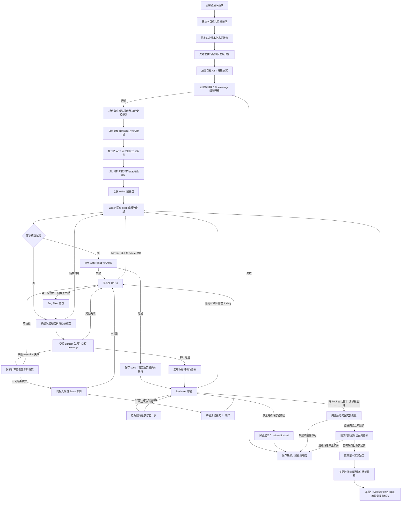

# 專案閱讀入口

## 資源與單元相依的提示分工（2026-10-26）

`isolatedResourceSystemRule` 與完整資源角色規則共用同一分工：資源計畫準備已批准的應用 I/O，參數仍由測試提供，來源支持的相依 Mock 仍可隔離單元。移除「declared resources, not mocks」及 execution 的「without host-declared resources」絕對限制，避免與既有 helper 隔離規則互相矛盾；不改資源計畫、runtime、Checker 或品質 gate。Mock 成功不等於真實資源驗證。

execution Writer 固定 system 說明去除重複教學，普通無資源時由2550字元縮為1574字元，保留來源形狀、匯入、不可變綁定、假說及隔離約束。既有中性案例在完整來源不變時回到2000輸入tokens內；此數字不是實際 tokenizer 或任意專案可容納的保證。初始 seed 仍使用自己的契約，完整來源／必要 setup／觀測不裁切。

## 呼叫端參數 Mock 的結構修復（2026-10-26）

`source_parameter_mock_repair.py` 處理已被 Checker 證明錯把函式參數當模組屬性的 patch。完整來源 hash、唯一普通目標／測試、qualified 標準 patch、唯一 target call 及其 positional／keyword 參數必須一致。工具提出只改結構的封閉選項：移除錯誤 patch，建立測試自有的標準 MagicMock，原 alias 繼續傳入目標；既有設定及斷言只增加來源已使用的單層成員前綴。原測值、expected、斷言方法／參數／次數保持；整理 scope 縮排時使用 token 位置保護多行字串，保留註解與空行。

這條路徑沿用 `sourceLiteralArgumentRepair.ts` 的 AI 選取、Python 重規劃、Node 獨立位元組重組與 hash 核驗，新增 `parameter-mock` request scope，限制 execution 的 Writer 修訂。完整目標、失敗方法與選項交 AI；不傳整份模組或資源 schema，不據此產生 oracle。未知綁定、setup hook、重綁、展開與 alias 逃逸回原有限 Writer 修訂；套用仍未批准，必須新 native／真目標／隔離證據，full 及品質政策不變。

## 來源綁定的 Mock setup 修復（2026-10-26）

execution 的結構修訂遇到已核實 immutable datetime/date 屬性 patch 時，`source_mock_setup_repair.py` 重新執行同一靜態 Checker，核對完整模組 hash、唯一普通目標及單一普通測試方法。只接受來源穩定 from-import 的單一呼叫成員，以及明確標準 `with patch(...) as alias`；來源其他成員／constructor、別名逃逸／重綁、反射及來源改寫使計畫失效。規劃不匯入應用。

AI 看完整目標、完整方法與完整替換 scope，只能選既有 ID 或 `ABSTAIN`。替換把 immutable method patch 移到 canonical class 綁定，同步同 alias 的標準 Mock 成員前綴，保留 literal fixture、斷言方法／參數／次數及 scope 外位元組。Python 重新規劃、Node 獨立重組並核對 source／test／plan／candidate hash；事件永遠未批准。合法放棄回原有限角色修訂，不增加第三次恢復或重置計數。

真正 native once 斷言失敗且被呼叫至少兩次時，`sourceLiteralRepairGuidance` 可附同源同成員的完整 literal 呼叫提示。這只導航來源，要求 AI 區分 setup 與 target 呼叫、保留精確參數與順序，不把靜態呼叫站數當 runtime 次數或以弱斷言掩蓋失敗。修訂後仍走原範圍、綁定及實際隔離執行；full 不啟用此 setup 片段路徑。

## 初始執行草稿的修訂接續（2026-10-26）

`runExecutionVerification` 明確啟用候選流程的 `continueUnexecutedWriterDraft`。沒有基線且尚未嘗試 native 執行時，結構拒絕保留目前完整候選供下一次 Writer 修訂，例如補 import 後再修下一項 clock setup；`retainedCode` 不前移，草稿仍 rejected／不可執行。`writer-draft/continued` 只保存摘要及未批准狀態。首次 native 嘗試後、已有基線或 scope 拒絕仍回復原保留版本；full 與其他呼叫端預設不啟用，原期限與次數不變。

## 種子範圍及來源依賴綁定（2026-10-25）

`requestBudgetedOne` 由目前工作狀態標記 `single-test-seed`，不從提示字串或模型名稱猜測。完整 length 回覆若已寫出多個方法，即使含斷言，也以 `seed-scope-overrun` 使用原有一次格式修正；不擴大額度完成非本次範圍的 suite。首問續寫可切回原完整指令，原始指令 seed 則沿既有續寫恢復；仍重算輸入、保留 floor、同期限及兩次上限。單方法與其他 scope 維持原路由，截斷內容不當候選。

`mock_behavior.py` 分開 canonical 依賴綁定與 provider 等價證明：完整來源中穩定的 `from datetime import datetime as clock` 可供 `patch("application.clock")` 隔離來源的 `clock.now()`；不能據此推定 `patch("datetime.datetime")` 會改到該拷貝綁定。兩種證明共用同源唯一目標、重綁／反射撤證及 target／owner 防護。Mock 仍須實際傳入或在生效 patch 內觀察到真目標，合法位置本身不是通過；診斷不把「未證明觀察」誤寫為「位置未知」。

## 物件配方重放核對（2026-10-24）

`ParameterFixtureSession.prompt` 以 callback 交付與實際提示完全相同的一份案例副本；未容納案例不交接。`requestBudgetedOne` 在新增方法簽名前附上精確控制提醒，例如讀取哪個屬性必須拋出哪種內建例外，以及目標實際正常返回或拋例外，避免把 getter 例外誤寫成 None 值或把已捕捉的例外包成目標的 assertRaises。完整配方與來源仍保留。

`prepareWriterCandidate` 合併後呼叫 `checkParameterFixtureReplay`；Python 的 `--check-replay` 只解析來源與測試 AST，不 import 應用或執行候選。排除目前基線方法後，只核對可保守解碼的一個新方法；明確控制矛盾記為 `parameter-fixture-replay / contradicted`，沿原新增範圍拒絕與 Writer 修訂。簡單測試自有getter類別僅在靜態核對模式解碼：無繼承／未知decorator，欄位與無參數初始化只含純量，property只拋明確無引數內建例外；按真正的receiver核對，不能把巢狀物件的property當外層讀取。其他語法保持unknown，照常實跑重審；matched只表示靜態控制一致。來源、模組、native路徑、候選、目前基線hash及原觀測指紋皆核對；seed provenance不當成目前基線身份。

Bug Fixer 可在 Writer 合併鉤子之外產生新的可執行基線。`writerAdditionMethodInstruction` 若缺少該完整基線 hash 的盤點，會透過同一個 AST 盤點工具重新取得方法，再選取新增名稱；失敗仍明確停止。這只補足當前候選的方法身份，不重用舊盤點、不更改基線，也不授予新的執行或審查資格。

## 突變副本的位元組與自相依（2026-10-24）

`prepare_trial_directory` 以bytes複製原測試並寫入來源，避免Windows把既有CRLF再轉成CRCRLF，破壞未修改基線的來源摘要。`mutation_environment` 仍先核原相依批准；只有可信driver選定的受測來源，才能在明確trial映射下以實際變異位元組重綁自相依摘要。其他依賴、原來源漂移、trial外路徑或多重映射保持拒絕。兩項修正不改候選集合、分母或ERROR／KILLED分類；基線通過不代表變異體都能量測。

## 補測 Writer 的獨立契約與輸出預算（2026-10-23）

第二輪起，`buildWriterAdditionSystemPrompt` 直接提供單方法補測契約，不先載入完整 suite 要求再附加覆寫。`buildWriterExpansionPrompt` 保留完整證據與已執行基線，只減少重複的固定說明。修訂中的完整未批准候選仍供診斷，合併永遠以原基線為準；新候選仍經原保留、Checker、Reviewer 及 coverage／mutation。

`requestBudgetedOne` 由實際基線狀態決定 `writerOutputScope=single-test-addition`，不是從模型名稱、提示文字或單純非 seed 狀態推定。Local 新增方法與其修訂以1536為初始輸出預留，較小容量沿可用預留，較高 learned floor保持；`roleRequestBudget`、`assessPromptCapacity` 各容量重算、生成前預留與 wire `num_predict` 一致。既有角色 learned floor、一次輸出恢復、原 deadline 與完整證據要求保持；其他角色、完整檔案修訂與遠端 provider 不借此 scope。較短契約及有界 cap 不代表整個車輛專案已通過。

## 參數物件受控補測（2026-10-23）

`parameter_fixture_experiments.py` 與 `parameterFixtureExperiments.ts` 補上頂層函式的物件參數實驗。它與既有實例狀態實驗分開：AST 只從通過候選解析受控物件與 callable 配方，按當前來源缺口選取參數屬性的缺少、假值及 getter 例外，worker 重新推導計畫後才在全新隔離程序呼叫真實目標。常數 factory 每次建立新的回傳；identity factory 返回實際收到的同一參數，不把任意 lambda 當成可求值程式。

觀測綁定來源、seed、目標、模組、資源計畫與配方摘要；必須證明目標 frame 進入及 profile 未被替換，失敗、I/O、ambient read、不可重播結果與來源漂移不授證。工具16秒階段一輪只執行一例，避免4秒冷啟動上限讓框架模組完全無法載入；未執行規劃仍留後續輪次。`ParameterFixtureSession` 分開保存嘗試與已交付案例，Context 不足不能截斷觀測或冒充已送出。

正式流程仍是 AI seed→執行→Reviewer→coverage／mutation→依缺口實驗→AI 新增測試→合併保留→重跑重審重測。頂層數值突變探測在無物件觀測時照常保留；class instance 的有序狀態實驗維持既有契約。工具不產生 unittest、不降低門檻；目前不支援任意自訂 fixture 類別、輸入相關的計算 lambda、async 或未知 setup，結果須明示 unsupported。

## 無 Trace 的種子範圍、局部 fixture 修復與來源定位（2026-10-23）

`review_test_facts.py` 額外收集不依賴 literal 解碼的 `targetCallSyntax`，只列可保守解析到 canonical target 的直接 AST 呼叫站（行／column）。重綁與未知接收者不推定，巢狀函式／類別 body 不計入；此為語法下界，不能當執行次數或 expected 證據。`reviewFacts.ts` 核驗位置與唯一性，不將這份陣列加到 Reviewer prompt。`writerSeedContract.ts` 在無選定 Trace 時也拒絕明確多方法／多呼叫 seed；物件輸入保持 unknown，仍須實跑重審。Writer 生成及修訂都在所有來源、focus與資源語境之後重申同一最小範圍。

`bugFixer.ts` 將方法內 fixture 類別與整份外層 class 包裝分開：唯一失敗方法可保留原巢狀定義，合併不授批准，原 AST scope 仍保護其他方法、共享設定、簽名與 imports。canonical seed 外框預列 `types`，同名目標時省略該 helper import；包裝不寫測資或答案。

`ast_extractor.py` 的 `source_location` 綁定完整目標片段與實際起訖行；`sourceLineContext.ts` 核對片段 hash及列數，讓 Writer／品質 Analyst 對照實測檔案行號。coverage 焦點僅補少量鄰近行，長行指回既有完整來源，避免另一份完整函式占用 Context；全檔版本仍由預檢與 journal 核驗。位置不能當 oracle。

本機 Qwen 3B 的車輛 `get_plate_no_from_event` 已保留經執行及 Reviewer 的 seed，完成 builtin 突變7/12（58.33%），目標行10/14且仍缺分支；未達標。來源定位後仍重複既有情境。現有品質實驗工具回報 `instance-target-required`，尚不支援此頂層函式的物件參數；後續需補受控參數 fixture 實驗，不能把 unsupported 或空任務算通過。

## Writer 種子程式碼續寫恢復（2026-10-23）

2026-10-25補充：`writerSeedPromptMode` 於分析run啟動時固定，預設instruction。使用者可由命令「LLM Unit Test: 選擇 Writer 生成方式」保存code-completion；只有Local初始Writer seed（full與execution）可從首問使用同一完整可逆提示及無body外框，其他角色維持原傳輸。偏好續寫仍重複時，原唯一恢復切回指令契約，不重複嵌套註解或增加第三問。缺合法外框不猜碼；明確stop、來源／候選綁定及原候選品質流程保持。多個重複fenced方法外框且無unittest斷言另列repetitive-test-shells，不再只因test_簽名就擴大輸出。設定不是模型資格；同模型實測仍必要。

`writerSeedCompletion.ts` 只處理實測高度重複、尚無測試結構的 Local seed 恢復。一般生成維持模型模板；唯一重試可把完整角色與證據轉成可逆的逐行註解，結尾接 `targetContract.ts` 的 canonical import／class／方法簽名，以 `raw:true`（不送 system/template）請模型續寫。此包裝沒有測資、目標呼叫或預期值；原回覆丟棄，不續寫截斷內容。新輸入重算容量且不借舊耗時，原 deadline／計數與兩次上限保持。只有完整 stop 才接合模型原字串；完整 fence 則直接保留。後續仍經相同 AST、執行、Reviewer、coverage 與 mutation，模式選擇不授予模型資格或測試批准。

角色事件與 failure report 區分文字格式補正及程式碼續寫。固定框架指令可在有界去密節錄保留，但動態來源與秘密不能藉此公開。通用 seed 指引另外明示屬性物件不等於同名鍵字典、callable 成員須明確控制，避免 UI 參數 setup 與來源存取方式不符；不替模型提供 fixture 值或斷言。

本機 Qwen 3B 已有 BMI 真實完整通過證據；CodeGemma 2B 的比較尚未產生有效測試，不能宣稱任意 base／小模型已適配。車輛單目標與整個專案驗收分開記錄，不能以 BMI 或固定回覆回歸代替。

## Writer 重複輸出與可讀失敗診斷（2026-10-22）

`modelOutputDiagnostics.ts` 依完整詞法統計選擇恢復路由：高度重複且無可辨識測試的 Local Writer length 回覆，改用既有唯一重送機會附加固定格式修正；不採用前綴、不刪必要證據、不新增第三次請求。已改變提示不能沿用原實測輸入或速度，重新核容量並保留完整單次時間與原階段／target deadline。其他輸出仍走原有有界增額。

`ollamaResponse.ts` 在正式呼叫提供的隱私語境內產生 `model-output-preview-v1`：只保留有界非空行節錄、位置與樣本次數，先隱藏疑似憑證、提示來源重述及位置；不含完整 provider envelope，永遠未完成且不可執行。資格探針等低階呼叫預設不保存節錄。`modelOutputDiagnosticsPresentation.ts` 將逐次失敗、token、耗時及恢復決策呈現於函式／逐輪 failure report與workflow；資料經白名單讀取，文字統計非AST或品質批准，舊紀錄不能從hash復原原文。

## 可選事先角色資格（2026-10-22）

`llmUnitTest.requireRoleQualification` 預設關閉，側欄可勾選要求。固定樣本只驗證一小段角色能力，不能保證正式專案成功，因此它是可選的事先檢查。關閉時直接走 AI 種子、Checker、同候選 Reviewer、coverage／mutation 與修訂閉環；增容也不插入資格探針，不會把未測的角色標成 verified。開啟後保留同模型／端點／容量的開始前資格及增容重驗。每次執行凍結此政策；資源批准、完整輸入與實際候選品質門檻不受此選項影響。

主動按測試連線時，Local 的 `connectionQualification.ts` 逐角色核驗固定 Writer／Reviewer／Bug Fixer，第一個失敗即停，餘下標 not-run；HTTP／逾時／截斷／回覆格式與 Python 執行分開。`ollamaCapability.ts` 沿用宿主傳輸與完整 body 原期限，採 UI 的 API 等待設定，支援取消及忽略 AbortSignal 的傳輸超時；三角色固定樣本各有1024輸出cap。只記角色狀態、安全原因及數字，無 provider 原文；30秒 Python 固定樣本上限與模型等待分開。

## 容量選擇與測試重點（2026-10-22）

側欄以完整、邊界優先、覆蓋率優先及突變強化取代模型尺寸 Tier。這些是共同閉環的優先順序，不是品質門檻或跳過量測的模式；每次仍只處理一案／一缺口，新增後實跑並取得同候選 Reviewer 同意。覆蓋率重點優先選未覆蓋處，突變重點優先選存活變異；邊界重點優先來源支持的邊界策略及可執行數值規劃，沒有相應證據時回到其他真實缺口。沒有證據不發明答案。舊 Tier API 與報告 reader 保留相容，新側欄不再提供尺寸分級或自動降階。

`testFocus.ts` 提供中性任務指引與標籤；新重點僅在使用者開啟事先資格要求時，要求相同模型及容量的 Writer／Reviewer 資格。Mock scaffold 按來源使用點取得一次，初次 Writer 提示才附上，不受模型大小限制。新 seed 按完整提示、補正與 128 tokens 餘裕分配最高 4096 的輸出 cap；正常 EOS 可提前結束，舊截斷、期限與計數閘門不變。測試重點不改變 num_ctx，也不保證減少 Ollama 的模型載入時間。

`resolveLocalRuntimeContext` 接受明確正整數執行容量，保留原始 metadata；超出或缺少宣告的手動請求在 UI 明示未驗證。`contextGrowthCeiling` 只在宣告能覆蓋目前請求時授予自動增容邊界；否則只能使用已選容量，不把手動值或短探針當成模型上限。正式請求仍明傳 num_ctx，完整輸入與執行驗證均須獨立成立；只有開啟事先資格要求才檢查容量資格。

## 宿主傳輸與 Mock 證據回歸修復（2026-10-21）

`modelTransport.ts` 不再注入 caller dispatcher 或探查私有全域 Symbol。正式請求沿用目前的 `globalThis.fetch`；VS Code 仍決定 Proxy、系統憑證與 TLS Agent。在每次 fetch 的 `AsyncLocalStorage` 作用域內，透過 `undici:request:create` 對最終 Request 的兩個可寫時間欄位套用原期限餘額，避免 Agent 被宿主重建後失去設定。Subscriber 不拋例外；欄位不支援則以 `MODEL_TRANSPORT_TIMEOUT_UNSUPPORTED` 取消本次請求。這些欄位是需要回歸核實的 runtime 能力，並非穩定公開設定 API；非 Undici transport 保留自己的政策。完整 body 的原期限與取消仍由 caller 持有。`undici` 僅為測試建構 Agent 的開發相依。詳見 [Undici diagnostics channel](https://undici.nodejs.org/api/DiagnosticsChannel)。

`mock_behavior.py` 保留明確新 Mock 的身分，父路徑覆寫同時清除該路徑失效的子圖，不移除仍被其他成員或直接參數持有的物件。`validate_test_bindings.py` 對不可變 datetime/date patch 的拒絕要求完整模組與目標 AST 一致、直接 import 且沒有重綁／反射等撤銷；無法證明的情況交實跑確認。修復回饋把 Mock 次數明示為累積 history，要求先核 setup 與來源證據，不能一律改成較弱的 `assert_any_call`。

Cloud 啟動等待憑證後再次核對 owner、取消與專案 revision；舊查詢不得解鎖新 run。Custom 模型保存設定名稱並於重建時恢復欄位，晚到選單不能抹掉使用者尚未保存的編輯；Webview state 不保存金鑰或端點內容。相關回歸與安裝版宿主包裝重播不代表已完成 F5／DGX 真模型驗收。

## 修復回饋例外視窗、Mock 綁定診斷、鏈式 Provenance 與 v3 存活突變指引（2026-10-20）

`repairFeedback.ts` 的 `summarizeRepairOutput` 在單一 `FAIL:`／`ERROR:` 區塊超過 `perBlock` 長度限制時，若例外列之後附帶超長 `Calls: [...]` 或斷言 diff（如 `init_db` 產生 41 次 `execute` 呼叫紀錄），會先定位 `AssertionError:`／例外列並保留「標頭＋例外列視窗＋尾端摘要」，避免單純取尾端 `slice(-available)` 切掉失敗測試方法位置與關鍵例外原因。`dependencyMockContract.ts` 的 `executionFailureRepairGuidance` 針對重複呼叫 `AssertionError`（`Expected '...' to be called once. Called N times.`）、0 次呼叫、`expected call not found` 與不可變內建型別（`datetime.datetime`／`datetime.date`）屬性寫入 `TypeError`，在 `roleContracts.ts`（Writer 修訂）與 `bugFixer.ts` 按需注入精準修復提示，無命中時零額外 token 開銷。

`isolatedResourceContext.ts` 於 `ISOLATED_RESOURCE_ROLE_RULE` 與 `isolatedResourceSystemRule` 明示 `HOST_ISOLATED_RESOURCE_CONTEXT` 僅為提示詞區段標記、絕非可匯入的 Python 模組，同時維持 Reviewer／Writer system 規則字數上限。`validate_test_bindings.py` 攔截 `import HOST_ISOLATED_RESOURCE_CONTEXT`，並針對誤將目標函式參數當成模組屬性（`@patch('mod.param.method')`）、誤 patch 不可變 `datetime`／`date` C 型別方法、同模組 helper／跨模組 `from` 匯入使用點不符給出精準替換路徑；當未定義名稱即受測目標本身時直接提示 `from {module} import {owner or target}`，且於 `has_mock_behavior` 為假時列出無法對應受測來源使用點的 `@patch` 裝飾器與正確使用點。

`mock_behavior.py` 跨 `setUp` 與測試方法追蹤 `mock_children` 父子鏈（如 `mock_get_conn.return_value = self.conn` 與 `self.conn.cursor.return_value = self.cur`），使鏈式子 Mock 上的呼叫與斷言能回溯至合法的受控 patch 來源；同時在單一測試方法掛載多個 `@patch` 時，僅忽略非使用點的額外 1-arg `@patch` 參數而不連坐註銷同方法的合法使用點 `@patch`。`qualityAnalyst.ts` 的 `qualityStrategyHints` 支援 `builtin-ast-v3` 以 `!r` 單引號格式化的存活突變描述（如 `mutation from 'LtE' to 'Lt'`、`mutation from '0' to '1'`、`mutation from 'return_value' to 'None'` 及 `call_statement_omission`），修復品質修訂階段 `measured-guidance` 的策略提示匹配。

## 模型傳輸逾時覆寫、雙時間上限與相依 Receiver 指引（2026-10-20）

先前以 caller dispatcher 覆寫 300 秒時間限制的做法已由上方 2026-10-21 修復取代，因為 VS Code 可能重建 Agent 或將其視為自訂 Proxy 政策。`requestTiming.ts` 與 `modelRequestTimingPresentation.ts` 仍只提取白名單內的巢狀錯誤碼（如 `UND_ERR_HEADERS_TIMEOUT`、`ECONNREFUSED`），不將供應商回應內文或私密路徑寫入診斷。

`executionTimingSettings.ts` 與側欄將「單次 API 等待上限（秒，1–86,400 整數）」與「每個函式總時間上限（秒，0.001–86,400，精確至毫秒）」分開解析、顯示與保存。開始分析前先驗證兩者並建立凍結的 `targetBudget` 快照（保留既有 `logicalRequests`、`transportAttempts`、`estimatedInputTokens`、`candidateAttempts`），各函式開始後固定絕對期限，重試不重新計時；非同步保存期間若執行權移轉、專案變更或取消則中止啟動。若宿主設定寫入失敗（例如未重啟宿主時 `targetBudget` 尚未註冊或資料夾範疇不可寫）僅記錄錯誤而不阻斷測試啟動；側欄並接手 Webview `appendLog` 轉發至系統日誌與 VS Code 警告通知，且於 `setModels`／`setApiKeys` 及跨 Webview 重建時自動保留或預選可用模型與環境狀態。

`dependencyMockContract.ts` 與 `mock_scaffold_generator.py` 依據 `dependency-fixture-contract-v1` 在初次壓縮與修訂提示、以及 Tier 3 scaffold 中保留來源實際消費的回傳與巢狀 receiver 路徑（如 `connect.return_value.cursor.return_value`），避免以 `None` 或純量覆蓋中層 receiver；同時提醒多個呼叫點不等於單次執行，禁止在同一 mock 堆疊多個 `assert_called_once_with`。

## 手動中止與側欄結果狀態（2026-10-19）

`ExecutionManager` 將取消與完成分開：`cancel()` 只取消目前 `ExecutionContext`，保留 active reservation；`hasActiveRun` 在停止及清理期間仍為 true，`begin()` 不接受另一分析。`canPublish()` 同時核對 owner 與未取消，阻擋晚到的一般進度與結果。取消命令只送出 `analysisStopping`，側欄維持停止中並鎖住重啟；只有該 owner 的 `runAnalysisSession` finally 完成工作與環境清理後，才能 `finish(execution)` 並送出 `analysisFinished`。`finish` 和 `SidebarProvider.endAnalysis` 均核對同一 owner，舊執行不能清除較新的 run。取消後不再發送模型請求或排程下一目標；收尾保存與清理是停止的一部分，不能提早當成執行完成。

`webviewContent.ts` 的結果卡將檔名／函式標題與分數分列，標題可使用完整卡片寬度，長名稱仍可換行。分組重建前讀取 live details 的展開狀態，以 `data-file-key` 維持 `groupOpenState`；toggle 只接受仍連在畫面的節點，避免舊 DOM 的延後事件覆寫目前狀態。新結果更新與平鋪／分組切換都沿用同檔案狀態；全展開／全收合另更新新分組預設，切換受測專案時重設。此狀態屬目前 Webview，不宣稱跨重新載入永久保存。

## Auto 先決條件與批次即停（2026-10-18）

`runAnalysisSession` 完成同次唯讀模型 metadata 探索後，與逐目標流程共用 `initialAnalysisModel` 解析端點、設定快照及確切 `num_ctx`。Auto/full 必須先有本次有效的 Writer／Reviewer 資格，Auto/execution 只要求 Writer；缺資格在資料夾掃描、初始化、Trace 與模型生成前立即結束並釋放 UI／環境鎖。手動 Tier 保留既有嘗試政策；明確單一 dummy 或經靜態 AST 確認的惰性 stub 保留無 AI 診斷通道，不宣稱測試或品質通過。

`executeSingleFileAnalysisWithBudget` 保存失敗 journal／報告並完成 finally 清理後，將終局錯誤傳回 `runSequentially`；整檔與批次不再吞掉錯誤並排下一目標。批次記為 failed，剩餘目標保持 pending。單一候選仍依原有限額修訂，來源掃描診斷與明確批准的局部環境續跑仍分開記錄；沒有增加 timeout、修訂次數或降低品質門檻。

## 開發驗證分層（2026-10-16）

`test/verification.js` 提供 `fast`、`integration`、`full` 與明確測試篩選的 `related` 入口。快速清單由來源行為與成本審查決定，不按舊耗時動態略過；其餘 Node／Python 測試全部納入整合，兩集合互斥且聯集完整。完整入口包含嚴格型別、lint、全部測試、Webview、歷史密鑰掃描與 production build。`--list` 只列計畫，空 related／未命中 selector 不能成功。舊 `test:unit` 仍對應完整驗證，低階 Node／Python runner 無參數保留原全量相容。此分層只調整開發回饋速度，不改產品內的 Checker、Reviewer、來源身份、assertion 保全、隔離或突變 gate。

## 容器預期值與三態審查證據（2026-10-16）

`review_test_facts.py` 先辨認真實目標結果及對應呼叫，再獨立解析預期值。直線局部 literal 變數可用於有界 tuple／list／dict／set；不執行來源、模型碼或任意運算。預期值無法解析仍保留可證明的 targetResult，未知輸入不附加懸空呼叫行號。容器修改、可變別名、未知副作用／fixture 或不完整及衝突觀測不授予核實。

每個斷言使用 `observationStatus=verified|contradicted|unknown`，分別表示與同 typed call 的完整受控觀測一致、已證明衝突或尚無法證明。這不是獨立業務需求的正確性判定。舊資料只有 `observationVerified=true` 才視為 verified，其餘缺值保持 unknown；非法或互相矛盾的旗標停止處理。正式提示只傳三態取代舊布林，安全 `reviewer-evidence-v1` 保留舊欄位並增加三態與計數，不新增完整 Trace 副本。

Reviewer 若只泛稱同一個已實跑、同呼叫核實斷言「沒有經觀測確認」，整份 assessment 視為契約矛盾，走既有一次補正；不刪 finding 或自動批准。具體修改、新輸入、獨立需求與真正缺少的證據仍可審查。AST 只是證據綁定工具，不能自行產生 assertion oracle。

## 角色傳輸與 Reviewer 證據核對（2026-10-16）

五個正式模型角色共用 `requestBudgetedOne → requestLlmApi → SerialRequestQueue → provider adapter`。Analyst 使用 `semantic-json`，Writer 與 Bug Fixer 使用 Python text，Reviewer 使用 `review-json`，QualityAnalyst 使用 `quality-json`；Mocker 是 Python scaffold 工具，沒有另一條 LLM 傳輸。連線資格只核對固定樣本，不能代替正式角色的完整來源、候選與執行證據。

側欄 JSON 探索與 Custom／Cloud 資格使用 `requestJsonWithTimeout`，原絕對期限涵蓋標頭、重試／思考量回退及完整 body。忽略 AbortSignal 的 transport 也不能讓呼叫者無限等待；晚到回應與被重試捨棄的 body 以非阻塞方式釋放，HTTP 錯誤不解析供應商原文。正式請求延續既有 shared／role／target 期限；超時文案分列本次傳輸實際可用額度及設定的單次上限，不把 6,000 秒設定說成當次仍有 6,000 秒。

10/16 01:03 BMI 已有六次完整回覆與一次 Reviewer body 超時，65,536 Context 下完整提示均可容納。第一份審查引用不相關行，補正仍以泛稱要求重新核算已觀測結果；第一份 Writer 修訂又把整個 tuple 精確相等改成近似值與索引斷言，保留 gate 正確拒絕。最後保留五個可執行測試，但未完成同候選審查，突變未量測。歷史資料沒有完整 Reviewer facts DTO，當前來源重建不等於歷史 wire 原文；新安全證據事件用來區分未組裝證據和模型忽略證據，不能當作批准。

`review_test_facts.py` 對 call、assertion 及 mock 證據共用原有 setup 保守條件；自訂 fixture／run／未知 dispatch 不授予精確觀測旗標。Reviewer 的重複核算矛盾檢查另要求同方法、同 `targetCallLine` 的 returned-call 與 assertion 核實及同候選成功執行，缺失保持可審查。具體程式／數值、不同輸入與獨立需求不借泛稱檢查否定，無效 assessment 只能有限補正，不能自動批准。

## 正式角色容量診斷與延後引擎預檢（2026-10-15）

`requestBudgetedOne` 在組裝完整 phase、來源、必要 setup、觀測、資源與 output contract 後呼叫 `assessPromptCapacity`。`prompt-capacity-v1` 的範圍固定為 `current-role-prompt`，記錄保守輸入估量、同完整請求的實測輸入、補正預留、可用輸入、輸出預留、已核實模型上限及來源。有效輸入採兩種數字的較大值；`minimumContextTokens` 在每個候選容量重新套用既有 `roleRequestBudget`，包含各角色輸出 cap、完整修訂候選大小與本角色 learned floor，不把起始容量較小的輸出預留帶到更大容量。DTO 只含固定標籤、數字與 null，不含程式或 provider 回應。

已核實上限來自同端點／模型的 show metadata 或合法舊 profile，分別標示 `ollama-show`／`stored-model-profile`；未知上限以 null／`unknown` 保存，不能授權增容。模型宣告上限、Modelfile `num_ctx` 預設、最近 `/api/ps` 分配與本次請求容量各自有不同含義；不能由一個標籤概括整個 Code Llama 系列。`promptCapacityPresentation.ts` 為日誌與失敗流程提供中英文容量數字、最低需求及下一步；明示估算不是實際 tokenizer 使用量，也不保證後續角色或測試品質。公開短角色探針的成功訊息亦說明固定樣本與正式完整提示的差異。

full 非 stub 的指定引擎由 `ensureMutationSelection` 延後到完整角色提示放得下之後，且在任何增容資格或正式生成請求之前唯一預檢。相同目標共用完成或失敗 Promise，維持指定引擎，不因重試更換或重跑。預檢子程序最多10秒且不超過原請求剩餘期限，前後核對取消、target 預算及來源版本；不延長原單次、shared、stage 或 target deadline。此順序避免提示必然超額時先花時間探測外部引擎，不代表略過 Checker、Reviewer、同候選批准或實際突變。

10/15 18:41 BMI 在初始 Analyst 的 `prompt-budget` 停止，約19秒、正式生成與候選皆0，與12:47／13:05的300秒 HTTP 等待不同。以該批完整 evidence 重建 wire，固定角色指令去重使提示估量2410→2302 tokens；來源、必要 setup、10筆成功／1筆例外觀測與2187 bytes的 transport schema 均保留，Trace JSON 段落逐位元一致。完整輸入仍大於2048，還需補正及輸出空間；此精簡不能當成2K Context全面支援，也不是新70B實驗室驗收。

## Ollama 串流、排隊期限與傳輸證據（2026-10-15）

`requestLlmApi` 從入隊開始沿用原絕對期限；`SerialRequestQueue` 將呼叫者的等待結果與實際工作生命週期分開。等待時過期或取消會立即返回且之後不啟動該項；已啟動的工作仍須真正結束，不能用提早 rejected 的 Promise 釋放序列槽位。未發 HTTP 的排隊失敗只記 queue 證據，不虛構 transport 或模型數字。

正式 Local 與側欄三角色資格探針皆請求 `stream:true`，經 `ollamaGenerationResponse.ts` 有界接收 NDJSON。只有唯一 `done:true` 終端與 EOF 都成立，才能交既有 length、格式、敏感內容及候選 gate；UTF-8 分段、錯誤、截斷與大小上限均不授權前綴。普通 JSON 保留歷史 missing-done 相容，明示 `done:false` 仍拒絕。資格 deadline 覆蓋標頭及 body；失敗清理不等待可能永不完成的 cancel。

`model-request-progress-v1` 記錄 queued／dispatch／HTTP 提交／標頭／首 bytes／首回答／完整讀取及排隊失敗，只投影數字、固定標籤及實際送交 fetch 的 body hash／bytes，不記完整提示或供應商回應。HTTP 提交不是伺服器收件證明，讀取完成不是品質批准；首回答時間與 HTTP 等待、模型實測耗時分列。最近載入與請求容量不同時提示可能重載，使用者的容量偏好仍保留。

10/15 12:47、13:05 兩批 BMI 都在首個 Analyst 的 HTTP 等待約300秒後停止，queue只有0／1毫秒，尚未進 Writer／審查／突變；沒有 length 回覆，不能歸因1024輸出額度。短生成兩端成功不證明完整 schema／提示也成功。容量差異及舊 build 是追查事實，尚無 DGX 服務日誌或新版完整實測，不能將本機整合通過寫成70B驗收通過。

## Mock 與工具契約修復（2026-10-15）

首次與修訂 Writer 都收到已核驗來源的必要 iterable／索引消費指引；可省略 raw topology，不能連帶丟掉 actionable setup。`source_setup_call_contract.py` 提供有界、同目標雜湊的參數屬性讀／寫／呼叫拼字，讓 UI 替身支援實際 dot 屬性與方法，並保留實際 module-global 呼叫參數。這些事實不供具體型別、值、斷言答案或 patch 權限，重綁與未知控制流保持未知。

Trace 合法的全域 `parameter:null` 診斷維持 `needs-input`／`complete:false`；真正 malformed wire 以 `trace-contract` typed 錯誤停止，不以 journal 或 legacy 載入錯誤取代。普通 Writer 增量只由已證明的 AST 盤點決定新方法包裝名稱，未知盤點停止；模型仍寫完整 body，新名字不繞過去重、執行或批准。Bug Fixer 新 import 額度由 Python AST binding 決定，既有／重複不計，遮蔽及原方法保留不放寬。

`mock_behavior.py` 對明確標準 `types.SimpleNamespace` 建立有界物件／成員身分圖，追蹤其中真正注入目標的 Mock；透過別名改動成員會撤回原證據。未知工廠、反射、動態 kwargs、手動預呼叫與偽斷言不授予行為證據，既有目標保真與真實執行門檻不變。

共用突變試驗器在排程及 setup 後確認剩餘 stage 可支付成功 baseline 的實測成本，不足則保持 NOT_RUN／partial。已啟動而掛住仍 TIMEOUT，原期限、分母及同測試審查批准不變。

## Analyst 輸出長度恢復（2026-10-15）

`num_ctx` 決定請求 Context 容量；`num_predict` 限制單次生成長度。自動容量 `0` 不表示輸出無上限，初始 Analyst 短計畫仍以1,024 tokens開始。`requestBudgetedOne` 對 Local Analyst 的明確 length 回覆使用與 Writer 相同的容量／時間規劃，但持有獨立的本目標輸出額度。至多重送一次同一完整提示，輸入預留與 wire 輸出 cap 成對。`semanticWithContractRepair` 分別傳入原首問期限及原規劃階段期限；例如首問60秒、階段120秒，缺統計且首問耗45秒後，仍可在原階段內保留60秒重送。首問不得因提示組裝或資格探針而續期；重送、格式補正仍共用原階段／target／family期限及計數，未明傳雙期限的呼叫端保留原shared硬限制。未知速度不估量，若不足完整單次時間、容量不足或再次截斷即停止；新容量仍走公開角色重驗，完整候選仍須 Checker、Reviewer 與品質驗證。錯誤訊息列出合法 `num_predict` 數值，避免誤認模型 Context 上限。沒有70B角色事件時，不能直接認定其實際中止原因。

## BMI 增量補測與證據綁定（2026-10-14）

Writer 生成器的可用輸入額度先扣除實際 seed／addition system、output contract、完整 phase／baseline、案例事實、資源、觀測及分隔換行，並採用同一目標已學習的 Writer 輸出下限。最後送出前仍核對完整 wire 提示；不足時分流為預算問題，不能截斷必要來源。逐案補測保留各自的證據投影，不因外層預留重新附回全域觀測。

初始 Analyst 仍分析完整來源；Writer 先寫一個可執行種子，Checker 獨立執行，再由另一 LLM Reviewer 審查。同 source／run／target／test hash 批准後才量測覆蓋率及突變。`writerSeedContract.ts` 在提示確實包含一個完整受控案例時核對方法數與 literal 呼叫的精確輸入，並提供簡短 `WRITER_SEED_CASE_FACTS_V1`；不計算答案或把未知 Mock／動態呼叫判成通過。

品質不足時，`mutation_probe_plan.py` 可規劃比較點以下、相等、以上的有限輸入族，依來源直接 round 精度選擇探測間隔；每筆仍須受控執行。已通過 literal 輸入只用來避免重提相同實驗，不刪存活突變或改分母。`qualityTaskEvidence.ts` 把完整、同身分、未變異且可重播的 returned 觀測綁定本次 focus。`quality-task-v4` 只要求 Analyst 引用 scenario ID，不再另猜 expected；Writer 收到精確 args／kwargs 與實測結果。完整 typed 證據仍存執行產物，未知狀態不借失去型別的 JSON 證明。

`writerPhases.ts` 要求擴充回覆只含新增內容，`testMerger.ts`／`merge_test_snippets.py` 的 `writer-addition-v1` 模式保留不可變基線原文，再以 AST 合併新增方法。既有方法改寫、fixture 或 import 衝突均拒絕；可證明的裸方法只能綁定唯一既有 class。新的完整候選仍經結構、精確輸入、保留、Checker、Reviewer與同雜湊批准，不共享舊執行或批准。Tier 子任務及 Writer 修訂走相同合併入口。

Writer 的同層 system 指令明確以一個 focus 取代全面 suite／全部 survivor 範圍；末尾 `WRITER_FOCUS_CASE_FACTS_V1` 提供完整 `targetCall` 與實測結果，減少位置參數互換。literal 新呼叫不僅須在範圍內，也須涵蓋完整家族；只有部分已知 literal 的混合動態候選保持保守拒絕，完全動態未知仍須執行與審查。沒有新增方法的原基線回覆在既有修訂額度內補正，不重跑原分數。方法盤點的裸方法回綁採合併後真 AST 指紋，不以回覆文字雜湊冒充 AST。

`focusedWriterAdditions.ts` 把同步頂層函式的完整觀測族分成逐案 Writer 子任務，每案一個新方法、一個精確 literal 呼叫，最多兩次契約補正。Host 只累積 AST 合併的未執行草稿，不產生 assertion；全部案例齊全後，完整候選才進原保留、Checker、Reviewer及突變門檻。任一子任務失敗保留原基線，部分草稿不取得批准。家族期限按 focus 與基線雜湊固定一次，外層修訂及 Tier 回退不續期；角色、傳輸及 token 計數仍共用原 target。class、async及未知狀態保留原生成流程。逐案提示只投影同 typed input／result 的完整觀測；Trace 合併後以真實新 ID 引用，原 ID 相同不能借用舊案例。完整來源、setup及已執行基線保留，前案未執行內容只列 AST 方法名稱與雜湊；單案請求不再附回全域 Boundary／Numeric 觀測，完整產物仍保存在原紀錄並供整套驗證與審查使用。

`planAnalysisTargetBudget` 在最外層依輪數建立一次計數額度；五輪44次 logical request 讓初始分析、Writer、Reviewer、品質分析、容量探針與有界修訂共享足量額度。預設上限64次，傳輸與 token 估量同步有界；明確設定仍覆蓋，原10分鐘 deadline、巢狀共享及先驗證後消耗規則不變。這是開始前規劃，不是失敗後續期。

對可證明的簡單 unittest 基線，`writer-addition-context-v1` 以 AST 提供完整 imports 與唯一 class setup，另列原始基線 SHA-256 及既有方法名稱；舊 test body 不重送給逐案 Writer，避免舊輸入混入當前案例。Host 仍以完整原始基線合併、執行與審查，投影本身不能執行或取得批准。fixture、helper、全域狀態、裝飾器及未知結構不做此投影，保留完整提示；真正工具／契約失敗直接停止。

逐案拆解只適用初次品質生成。有失敗候選的 `writer-revision` 保留具體執行回饋／Reviewer finding 與完整原候選，交原修訂提示；不能改用 fresh case prompt 丟失問題，也不能把尚未批准的可執行草稿當新不可變基線。原始基線合併、passing 保護、重新執行及同版批准維持不變。

baseline／draft 只在完全相同的獨立 Python fence 已存在時引用去重；基線原文只是較大草稿的 prefix，不代表已完整獨立供應。修訂提示因此能明確區分原已執行基線與尚未批准的新增方法。

Reviewer review-v7 新增具體例外依據檢查；同候選實跑、同 literal 輸入的 returned 觀測可標記 return→exception 建議矛盾，沿用一次契約補正，不自動批准。`candidateMethodSummary.ts` 只讀同身分 AST 盤點與實際保留雜湊，分開生成／新增／拒絕／保留；未知不補零，合併不重算模型生成。最終報告留摘要，failure／workflow 留逐候選流程。

## 容量、審查與 Mock 修訂（2026-10-14）

`localRuntimeMetadata.ts` 共用 Ollama show／ps 探索，HTTP與body解析共用有界期限，僅投影固定狀態、數字與端點摘要。`SidebarProvider.prepareLocalAnalysisRuntime` 在取得本次執行所有權後更新 execution snapshot；UI與正式請求共用同份上限／分配資料。cached上限須同端點、模型且合法；探索不授予角色資格，也不寫回模型profile或使用者容量偏好。`model-runtime selected` 保存 fresh／cached／unavailable 診斷，避免未知上限被泛稱成模型無法執行。

`planWriterOutputGrowth` 分開已核對 num_ctx 內的輸出增量與需要可信上限的增容。相同完整提示的 length transport 可提供實測輸入與生成耗時；輸入保留 max(估量, 實測) 及128 tokens餘裕，輸出受容量、單次時間及原階段餘額限制。新容量仍重驗角色；正式请求在探針完成後建立一次單次期限，stage／shared／target期限從首問前固定，重送前重新檢查餘額，不續已發送請求或重設計數。截斷前綴不保存或執行。

Reviewer v7 不新增必填JSON欄位。AST事實增加完整標準assertion及直接stdlib with-patch的同方法語法，僅用來拒收完整重複的修改提議。當前指令回聲、泛用verify要求及同canonical import／assertion／patch重複提議走原本有限契約重審，不能刪finding自動批准。literal內容、其它方法的patch及未知callback／業務語意不能借這些語法事實否定；事實工具入口明確使用UTF-8，支援非UTF-8 Windows console。

`dependency_fixture_contract.py` 對安全單一comprehension補充 iterable及常數索引的結果消費形狀；Writer提示因此能指出真正的 `receiver.method.return_value`，而不產生資料內容或expected。patch初始化ERROR由標準mock堆疊及本次測試行核對，交Writer整理fixture；一般目標例外仍按原唯一方法失敗分流。來源 `__file__`、可選屬性及path constructor輸入提示保持來源綁定，非static類別的self／cls不當外部protocol物件。

## 車輛批次候選修復（2026-10-13）

`generated_test_runner.py` 區分純 `_FailedTest` 載入失敗與真正模組身分不符。純載入失敗保留 unittest 原始匯入原因，並輸出不含例外原文的版本化診斷與執行身分。`generatedRunnerDiagnostics.ts` 以 result／invocation 雙產物、current source／test byte hash、native path、target、run ID、profile 與 failed 狀態核對；僅 pure load failure 可交 Writer，exit code／身分矛盾或工具資料無效直接 typed stop。成功仍須原來的 coverage／invocation／isolation／Reviewer gate。

Writer 提示的完整中性範例保留作內部回歸，正式語境改為不含範例模組、程式及答案的文字指引。抽取只正規化可證明的外框縮排，保留多行 literal 與尾端程式；literal 內的 `[PYTHON]`／fence 不當作傳輸包裝，多完整候選不任選。`target_result_evidence.py` 按方法詞法範圍核驗局部 import；並窄版支援來源直接寫入參數屬性、測試 fresh `SimpleNamespace`、同物件在真實呼叫後的狀態斷言。AST 只證明相關性，不產生 expected；重綁、未知 helper、Mock、覆寫與分支不借此通過。

Reviewer 的同候選事實新增 inherited unittest assertion 語法；只有 exact mechanical claim 與實跑／AST 明確矛盾才要求原期限內重審，沒有刪 finding 自動批准。有序 instance 實驗對頂層函式不啟動 worker，保存真實不適用原因；一般數值 mutation probes 保留獨立支持，空觀測不冒稱預算超額或 oracle。

## 跨專案 P0／P1 與 Tier 分流（2026-10-12）

主流程保持 Analyst → Writer → Checker（真實隔離執行校驗）→ 另一 LLM Reviewer → 同候選批准 → 突變 → 品質缺口修訂。Checker 由 `generated_test_runner.py` 執行 unittest，依測試內斷言比對實際結果與預期答案，不呼叫 LLM；Reviewer 另以 LLM 審查輸入、預期值與依據。Checker 通過不證明獨立業務需求正確。`tierFailurePolicy.ts` 只對候選或修復契約耗盡降低生成策略；模型、環境、工具、預算與審查失敗不借降級回避。沒有可用 Bug Fixer 時由 Writer 修訂，仍保留已通過情境。

`batchPreflightPartition.ts` 以最後真正匯入檢查分開 loaded／受阻／未檢來源。`batchSetupContinuity.ts` 核對根、選取來源、初始化閉包、Python及實際fixture身份後，只排程已實測loaded目標；其他目標單獨記 environment-blocked、零模型請求。`batchPreflightSnapshot.ts` 在批次內保存最後預檢快照。局部完成不是整批通過，取消或身分漂移仍停止。

`compactWriterContext.ts` 的 v2 投影把來源 setup 放成原文區段，JSON內只引用完全相同已列來源；derived imports明示其性質。可斷言觀測與完整診斷分開，不把 non_assertable repr 當 return value。`mock_behavior.py` 只在完整模組來源與唯一目標相符且沒有重綁時，證明 module-member 原始位置與使用點 patch 等價；測試中未定義／遮蔽名稱與未完成骨架交 Writer，無法證明的外部呼叫不自動全部Mock。

`probeInputFixtures.ts` 載入來源綁定的有界 JSON；`probe_fixture_builder.py` 只解析有界 Python literal，不 import 應用或執行模型碼。測资包含四組 args／kwargs／constructor_args／constructor_kwargs，沒有 expected。未知物件仍需明確 fixture 設計，不能宣稱任意第三方型別都可重建。`probe_case_plan.py` 去除完全相同的自動規劃呼叫並保留 origins；每個保留案例仍新建 worker／資源，使用者測資及未知狀態不合併。

Trace 新執行預設60／15／5秒（total／planning／case），總時間與單例最多300／30秒，依成功預檢校準冷載入且不延長原目標 deadline。LLM 請求時間獨立計算。完整流程及失敗報告分開呈現分配與實際 planning／case 耗時；逾時不是函式例外 oracle。

Reviewer 依完整編號測試及同候選事實逐項檢查輸入／expected，不以自己的模型假設代替執行。`reviewerDiagnosticsPresentation.ts` 呈現有界且去密的原因、引用、行號、修改動作與assessment拒絕碼；可執行、審查建議、已批准、完整品質通過保持不同狀態。

`source_setup_call_contract.py` 輸出獨立的來源呼叫事實卡，與只描述物件消費形狀的 fixture topology 分開；Python AST正規化拼字不是原始格式或執行證據。每項綁定完整目標片段摘要與qualified target，標示 `assertionOracle=false`、`patchAuthorization=false`。required Writer語境列明可選屬性owner、真正的module-global呼叫參數與來源`__file__`；未知與超限不給具體操作權限，測試仍須實際執行及審查。

## 批次資格重用、輸出恢復與冷啟動（2026-10-12）

`batchRuntimeQualification.ts` 以同一頂層 `ExecutionContext` 持有 `RuntimeQualificationSession`，核對確認的來源集合、實體路徑、Python 與 venv 設定、已載入相依及 fixture 身分。只重用同端點、模型、容量及資格版本的完整能力判定；傳輸／執行不可用不形成負面能力快取。後續目標可沿用本批次已核驗的較大容量，偏好與跨批次儲存不變，所有實際候選仍重新執行與審查。

增容時 Auto/full 要求新 Writer／Reviewer verified；手動 Tier 依原本的當次角色嘗試政策繼續，Reviewer 探針失敗不封鎖 Analyst／Writer。`roleQualification.ts` 的 Reviewer 探針使用正式 `review-v7` schema 與獨立 `review-json` 傳輸，資格版本為 `python-unittest-v8`。安全診斷只保存固定原因碼、字數與結構統計，不保存 provider 原文。未取得同候選審查批准仍不得突變。

`writerOutputBudget.ts` 在一目標內記錄已確定耗盡的輸出 cap。`requestBudgeted` 對 Local Writer／完整修訂至多重送一次相同完整證據；較大輸出保留量與 wire `num_predict` 成對，必要時依已核實上限增容。2026-10-13 起 `outputRecoveryTiming.ts` 在首問前預留至多兩個單次額度，受明傳 shared deadline 與原 target deadline 限制；各次請求及其 HTTP／容量回退不續期，原 stage 與 target counters 不重設。當次 length transport 有完整數值耗時時估算較大輸出需要的時間，不足便記錄 `output-recovery-blocked`；未知時要求留足單次額度。截斷前綴完全丟棄。

`modulePreflight.ts` 的成功 `elapsedMs` 由宿主量測；`traceStartupBudget.ts` 在原剩餘時間內預分規劃、第一次案例重載與清理。Trace 外層最多60秒，未知時保留原5／12／20秒政策；Python 的 planning/case/total progress 保存實際分配。新的額度不增加既有 target deadline，也不把載入或規劃當成觀測。

`external_mutation_runner.py` 的 v2 適配補上現代 Python 整數 subscript 的 AST 差異，呼叫 Mutatest 原生 Index walker 與候選算子。probe 同時檢查算術與索引，TypeScript selector 只接受自檢通過的目前 v2；歷史 v1 報告仍可讀。基線、隔離、來源／測試摘要與零候選未評分規則保留。

`dependencyMockContract.ts` 只依現有 AST 的 receiver/use-point/完整 chain 給不可變時鐘 owner 指引；若來源證明時計回傳值再交 `strftime`，使用獨立 test-local alias 建立具體 datetime/date fixture，讓真 formatter 執行。將 formatter 整個Mock成固定expected會吞掉格式字串突變，不能以高行覆蓋當充分行為驗證。未知chain不猜用途，規則不代替當前需求 oracle。

## 超額時增加本次容量（2026-10-12）

`contextGrowth.ts` 接收完整最終提示估量、補正預留、實際角色輸出 cap 與已核實模型上限，只在超額時規劃足量容量，加128 tokens輸入餘裕並向上對齊1024，最後仍不得越過上限。設定未知、到頂仍不足或非法資料保持受阻；小提示不降低已成長容量。`requestBudgeted` 是所有正式角色的最終共用 gate，Reviewer 不再於進入該 gate 前以舊容量拒絕。

`localRuntimeRequalification.ts` 重跑公開固定角色探針與安全隔離執行，不自行連線或寫入設定。主流程以新 `num_ctx` 傳送每個探針，依上述 Auto／手動政策核驗當次角色，再更新 active profile 並重新核對完整角色預算。保存容量前後、上限、各角色診斷及耗時；已儲存選擇保持原值。探針、HTTP回退與正式請求共用原 deadline／target budget，增容不等於實際 GPU 分配或品質通過。

## Analyst 格式、短計畫與模型耗時（2026-10-12）

`modelQualification.ts` 不再以 Writer 的純 Python 生成資格推定 Analyst 格式。Analyst 使用 `semanticAnalyzer.ts` 的共用短計畫 schema：必要的 `test_strategy` 提供一個可操作起始情境，最多兩個 input hints、三個 key rules；相依、不可達路徑及 mock 摘要是有界的可選欄位。新回覆控制文字與筆數，舊完整計畫仍相容讀取；完整來源、setup 和執行證據不截斷，具體策略與目標參數 gate 保留。

Local `/api/generate.format` 帶此 schema；Custom 保留 JSON mode，Cloud 共用 schema。Cloud 的 OpenAPI `responseSchema` 傳輸投影只移除 schema 節點不支援的 `additionalProperties`，保留合法同名資料欄位、長度／數量與必要欄位限制，不改寫共用 schema 或本地語意 gate。Writer 仍生成 Python。Analyst 的無效回覆只交 `semanticWithContractRepair` 補正一次，沒有額外的隱藏文字重問；明確服務格式拒絕仍可在同一次 deadline 內移除格式參數，但提示文字保持完全相同。

`requestTiming.ts` 預先分配至多兩個 Analyst 單次額度，例如設定60秒時，階段最多120秒、每次最多60秒，且受目標剩餘時間限制。HTTP 重試、格式／思考量回退及排隊共享各自邏輯請求期限。Writer 的 length 恢復採上述 2026-10-13 階段政策，其餘角色維持原有政策；傳輸超時、取消與證據漂移不能觸發格式補問。

本機短計畫輸出 cap 為1,024 tokens，不高於原輸出預留；輸入預算與實際 wire `num_predict` 成對。已儲存的手動容量保持原值；完整提示超額時，僅本次執行可依上述流程增容。`model-request-timing-v1` 分開保存 queue／transport 事件及 Ollama 的數值 timing／token metadata，未知為null。`modelRequestTimingPresentation.ts` 將同次紀錄呈現在日誌、逐輪與失敗流程表；HTTP 等待可能包含服務推論，不能稱為網路延遲或GPU耗時。完整 provider 回覆不持久保存。

車輛 `_connect` 曾以6,125-token修訂提示修補160-token候選，因此明確單一小修補保留1,536輸出額度，避免無條件占用原三成預留。10/16 BMI 另證明短候選仍可能有多項 Reviewer finding，不能以候選長度當全部工作量。`roleRequestBudget.ts` 現以完整候選估量為基礎 `max(1536, ceil(候選估量 × 1.25) + 256)`，對已知小候選再加 `512 × max(findingCount - 1, missingScenarioCount)`，最多使用原輸出預留，且 learned floor 不降。這是保守字元估量，finding 不等於案例配額。

正式 Reviewer 工作量只由有效 assessment 結構計數，綁定同候選 hash 及同 feedback hash，在修訂時消耗；不解析任意 prompt 或自然語言。明確單一結構／執行修補採 `{1,0}`；未知／非法工作量、未知或大候選維持原預留政策。`promptCapacity`、增容估算及實際輸入／wire `num_predict` 使用同一份工作量，execution及遠端不改。各入口明傳自己正在修的候選；後續擴充的短無效片段不能用來縮限完整基線。來源、setup、資源、passing案例、期限及計數都保留；輸出中止、實跑與同版審查 gate 不放寬。

## Schema、角色契約與冷啟動修復（2026-10-10）

`initializationPlanning.ts` 在既有規劃閉包上呼叫 `schemaPlanning.ts`／`sqlite_schema_plan.py`。後者只做有界 AST 與 literal DDL 解析，沿可證明的本機 connection helper／cursor 鏈定位 `CREATE TABLE IF NOT EXISTS` 與保真的新增欄位遷移；不 import 應用、不 eval、不讀取資料庫。來源宣告的 ConfigParser fallback 只有在同一預覽明列空白設定 fixture 時才可使用；既有非空設定不覆蓋。TypeScript 核對來源摘要及精確 SQLite 地址，可將新 DB 資源、資料表、設定 fixture 與目錄／入口提案合併為一次預覽。已有 schema／seed 保留，衝突、未知路徑與無獨立來源證據的共享資源只列診斷。`sourceDependencies` 將跨檔證據納入 plan 身分，Python worker 重新驗證，`pythonSourceMode` 禁止 frozen 程序沿用原始碼路徑證明。`isolated_resources.py` 從驗證後結構建立每程序新資料庫，支援 literal default、UNIQUE 與 AUTOINCREMENT，從不直接執行來源 SQL。

`buildCompactWriterContext` 只投影目標與必要 setup 使用的 import，保守保留未知綁定，合併相同規則文字並限制 optional examples 的佔用。`dependency_fixture_contract.py` 由 AST 抽取直線 receiver 與實際消費的 return／context-manager 路徑，讓 Writer 分清 cursor.fetchall 與 execute 回傳值；未知 alias、重綁與控制流保持診斷。此契約的 `targetSourceHash` 明示為正規化目標片段，不冒稱原始檔 hash，且只供 fixture shape，不授予 patch 或 assertion 權限。`buildWriterRevisionContext` 保留完整目標、setup、規則、觀測與相依，只有完整相同的 source／current test 才改用引用；必要證據仍太大時由 `requestBudgeted` 保存估量並停止。Reviewer 的同候選 AST facts 與 execution 身分只反證明確機械矛盾或無實際改變的替換要求，未知語意仍須處理，不能刪 finding 變成同意。

Builtin／外部引擎共用 trial runner 在成功 baseline 後，以 `max(設定的 mutant 秒數, 2 × baseline 實測秒數 + 1)` 校準每筆時限，避免載入成本已超過原上限卻把全部 mutant 判逾時。序列／並行都受原 stage deadline 限制；時間用盡仍是未完成，不當 KILLED。`MutationRun`、Python scorecard 核對政策／設定／有效上限與分配公式；角色事件與逐輪報告呈現診斷，精簡最終報告保留原格式。歷史結果缺少新 timing 欄位仍可讀取，不補造時限或分數。

本機 `/api/generate` 經 `ollamaPrompt.ts` 將完整角色契約與 user evidence 用最終預算相同的換行合成 `prompt`，避免只讀 `.Prompt` 的模型模板遺失 system 指令；單一空格 `system` 抑制 Modelfile 預設回填。原模板、輸出格式與 context 設定保留，沒有模型名稱特例。指令可見不證明模型理解或各模板品質等價；角色解析、執行及品質 gate 不變。固定資格探針使用 `python-unittest-v7`，兩案例的斷言必須連結真正目標結果與獨立固定 expected，舊資格需重新驗證。

## 載入前初始化規劃（2026-10-10）

`plan_import_initialization.py` 在不 import 應用或依賴的情況下，掃描選取來源與有界本機匯入閉包，提供來源摘要綁定的目錄及外部 callback 入口候選。只接受可明確解析的路徑與直接模組呼叫；符合支援參數形式但無法靜態解析 receiver 的 mkdir 只記為 `dynamic-directory`，不求值配置或 helper，也不據此認定 receiver 必然是 pathlib。planner 本身不執行 fallback import，不推導資料庫 schema；規劃完整性只代表掃描完成，不證明所有初始化或函式需求皆已滿足。

`inspectProjectImports(..., planBeforeImport=true)` 先經 `initializationPlanning.ts` 核對規劃輸出。只有可確定候選時，直接回傳 `stage=initialization-plan`，保存 `importsExecuted=false` 與 `planningSources`。若 diagnostics 含 `dynamic-directory`，Host 先呼叫一次既有 `inspectProjectImports` 受控匯入掃描，使用當時已批准的 fixtures，完全不暫套新的靜態或實測提案；再核對來源閉包，將實測目錄建議與靜態入口候選合併。此路徑保存 `guardedObservation=true`、`importsExecuted=true`，原始實測另存 `observed_import_check.json`／`.md`；規劃列仍不冒充實測失敗。沒有新提案時沿用已完成的診斷，或在尚未診斷時執行既有預檢。

`ImportSetupController` 將合併清單呈現為一次預覽與一次批准，確認時再核對完整來源閉包及設定；批准後建立隔離資源、安裝入口替身並做一次實際重檢，真正的外部 callable 身分仍由 runtime 驗證。靜態待確認路徑取消時未曾 import；動態目錄路徑可能已完成初次受控診斷，取消不套用新設定也不再重檢。未知副作用、不支援的動態呼叫與缺 schema 仍可能受阻，不能宣稱所有情況零 import 或一次清單能解決所有初始化。

批次對待確認的規劃清單直接進入設定預覽，避免額外詢問一次「處理初始化」。確認後只有一次重檢；就緒接續原批次，取消、來源漂移或新的動態障礙均停止。初始計畫、可能的受控診斷與最後載入結果分開記錄，批次受阻總數更新為最後設定結果。

## 批次初始化後接續原流程（2026-10-09）

批次先保存所選來源、目標與初始預檢。使用者選擇「處理初始化設定」後，`AnalysisEnvironmentLease` 只暫時釋放 Python 使用鎖，原 `ExecutionManager` 的批次預約、模型快照、取消與輸出目錄仍保留。`ImportSetupController.prepare` 在獨占設定鎖下回傳明確結果、實際 fixture ID、Python、所選 targets／rows 與報告；來源或設定在顯示報告期間改變，也不得回傳 ready。父批次取消會中止子預檢。

ready 後 `batchSetupContinuity` 同步核對原選取來源雜湊、根目錄、targets、完整 loaded rows 及 Python，主流程另核對實際設定 ID。接續前清除父 execution 的已完成預檢失敗，涵蓋相依已修好但 fixture ID 沒改變的情況。直接沿用已完成的一次確認後重檢，不再發起額外初始化循環；各目標仍走正常預檢及完整 AI／驗證／Reviewer／突變流程。拒絕、取消、仍受阻或身分變動都不接續；「繼續測試並記錄失敗」保留為明確診斷選項。

`batch_manifest.preflightEvents` 與完整流程報告記錄初始計畫、隔離資源數、處理決定、setup 結果、接續／取消／失效及相對報告連結。`environment-blocked` 保留未開始的 pending targets、`complete=false`，不能將空結果清單誤判為成功；初始化就緒也不算品質通過。

角色提示以來源呈現的接收者／呼叫鏈區分 dependency mock 的回傳物件與末端值，並保留 import 作用域。NameError 只提供有界名稱診斷，不猜套件或改受測來源。Reviewer facts 增加受限的標準 `patch` mock 呼叫斷言：只支援明確來源綁定、直線呼叫順序及依賴使用點。已執行候選的 import 綁定錯誤或僅因使用呼叫斷言而要求改回傳斷言，會進既有一次契約修正；其他需求、品質或更強斷言仍可審查，矛盾回覆仍不能批准。

## UNC 名稱的本機虛擬資源（2026-10-09）

Windows 新增獨立的 `scope=unc-virtual`。`canonicalUncResourcePath` 將支援的網路樣式名稱正規化為 `//server/share[/tail]`，接受共享根目錄並核對裝置名稱、`IPC$`、跨層與來源交集；整個核對不查詢原 UNC metadata、不解析或連線原共享位置。`external-exact` 維持只接受本機絕對路徑，不將 UNC 混入原 scope。

advisor 僅從實際受阻的 `Path.mkdir(exist_ok=True)` receiver 提出精確候選；手動資源草稿使用同一契約。兩者沿用來源雜湊及設定版本核對，清單逐項顯示完整名稱與「僅本機暫存、不是網路授權」的說明，確認後才保存，再執行唯一一次重檢。取消不保存、不重新預檢；重檢發現下一個障礙便保存報告並結束。

Python 在本機 owned lease 內建立 worker 專屬空白目錄或明確文字／SQLite seed；原 UNC 名稱只作邏輯匹配，不讀取原 metadata 或內容、不寫回、不連線。同一 worker 沿用資源，下一個 Trace case、baseline 或 mutant 重建；外層於子樹停止後核對擁有權並清理，取消／逾時及清理失敗沿用原契約。突變中的 UNC 字面地址不變，不從副本布局推導其他遠端位置。

runtime 前置 guard 涵蓋支援的標準 Python 檔案／路徑 API 及已知 `ntpath` 別名，在底層檔案或名稱解析動作前阻擋未宣告操作或改用已宣告的本機資源。這不是 OS sandbox，不承諾隔離任意原生 extension 或未支援私有 API。模型資源語境僅新增穩定 alias／path hash；完整名稱留在本機確認清單，alias、schema 與 seed 不能冒充 assertion oracle。

## 精確外部路徑使用暫存資源（2026-10-09）

固定本機絕對路徑可使用 `scope=external-exact`；只支援專案父層範圍之外、與來源不相交的精確邏輯路徑。預檢由實際受阻的 `Path.mkdir(exist_ok=True)` receiver 提出候選，仍須走清單預覽、明示確認、來源／設定重核對與一次重新預檢；也可由資源草稿宣告。沒有確認就不寫入設定、不批准原路徑 I/O。

TypeScript 與 Python 同步驗證路徑及來源版本。外部資料在 worker 的獨立命名空間建立，目錄及其 seed 共用對應位置，各 worker／baseline／mutant 重新建立；不讀取或複製原內容。突變副本中的固定絕對路徑保持原邏輯比對，不使用來源相對位置推導外部別名。若 `__file__` 衍生路徑隨副本變動，未宣告的新地址仍受阻，不能當 killed 或有效分數。

本機確認清單保留精確映射供使用者核對；給角色的資源摘要只提供穩定別名、路徑雜湊及 schema／seed 語境，不另加入完整外部路徑。別名是設定身分，不能當成函式回傳值或 assertion oracle；既有來源與執行證據不由文字替換改寫。

## 突變副本與資源映射使用同一份布局（2026-10-09）

突變工具先根據測試中的目標匯入，決定要建立平面模組或套件副本。只有套件匯入時不另建平面目標；同時使用兩者才保留兩份。初始化設定以這份布局的明確來源／副本對應重新綁定，不因暫存目錄中存在同名檔案就猜測對應。來源雜湊、入口行號、資源 schema／seed 與相同計畫身分仍須核對。

套件初始化或 helper 若以平面名稱或較短的套件名稱匯入同一目標，先從已核對副本所在目錄及 trial 內各層父目錄解析，再使用原相依搜尋路徑；不另造平面副本及資源別名。這避免未使用的來源副本製造多餘目錄別名，令原本通過的測試在突變基線受阻。真正不相容的別名仍拒絕；無法準備布局或重綁設定時保存基線錯誤，不執行突變、不產生有效分數。測試必須能證明實際套件副本被修改後會失敗，不能落回原始目標。

## 專案父層資料目錄（2026-10-09）

`Path.mkdir(exist_ok=True)` 的實測 receiver 若位於所選根目錄同父層的不相交子樹，advisor 產生 `resourceScope=project-parent`；TypeScript 核對後建立含 `scope` 的資源規則，預覽明示原邏輯路徑與暫存映射。省略 scope 保留原本專案內語義。Python 以獨立實體命名空間處理內外同名資源，突變副本沿核對過的來源位移產生精確別名，不讀取原資源內容。

初始化比較分開處理真實新障礙、未解舊障礙與診斷不完整。工具失敗保留有限的結構化原因，取消／目標預算維持原分類；前次原因只保留於歷史，不補成當次觀測。

## 隔離資源生命週期（2026-10-08）

`importFixtures` 規則增加 `resources`／`resourceSourceHash`；宣告、來源與 seed 都納入同一計畫 ID。`isolatedResources.ts` 驗證純資料規格，`processRunner` 擁有外層 lease，等待子樹關閉後核對並清理；清理結果記入 `ExecutionContext` 事件與分析 journal。

`isolated_resources.py` 在匯入前建立每個 worker 的空白資源，只重導明確路徑的 I/O，保留真實來源身分；同 PID 的 import／call 沿用，每個 Trace case、baseline、mutant 分開。`runtime_policy` 只給受測應用存取宣告資源，生成測試仍禁止直接 I/O。`import_fixtures.mutation_environment` 將相同邏輯批准映射到已核對副本；runner 核對資源身分，缺 schema／初始化失敗不能算 killed。

初始化預檢可從真實 `Path.mkdir` receiver 提出目錄資源；額外文字與 SQLite schema／seed 由「隔離測試資源」編輯、預覽、保存、重檢。不複製正式資料、不猜 schema、不代呼叫任意 setup。角色共用 `HOST_ISOLATED_RESOURCE_CONTEXT`，知道可用資源與 suite 範圍，但資源不是 expected oracle。操作與限制見 [隔離測試資源](docs/isolated-test-resources.md)。

## 初始化預檢的明確終點（2026-10-08）

`ImportSetupController.prepare` 每次操作只有「初次檢查 → 預覽並確認一份清單 → 套用 → 一次實際重檢 → 結束」，取代最多八輪連續確認。若重檢揭露下一個初始化問題，保留新建議與來源位置供下次手動預覽，不再自動彈出下一個確認視窗；仍是原障礙則明示受阻，缺套件／API 或不支援的副作用不猜測替身。批次入口傳入已確認的 targets，避免轉入設定後重新掃到已排除來源；直接專案入口仍檢查所選專案。

`importSetupSession.ts` 保存根目錄 `import_setup.json`／`import_setup.md`，連至每次 `1/`、`2/` 的完整 `import_check` 與可用設定提案。終態區分 ready、blocked、cancelled、incomplete；比較實際例外、來源行與初始化呼叫，受阻數相同也能辨識下一個障礙。每次明確 `inspectProjectImports` 只刷新目前 execution 的已完成失敗快取；單次掃描內的共享快取、其他執行及隔離規則保持。模組可載入只代表預檢完成，不代表函式測試、Reviewer 或突變已通過。

## 保護工具事實與已通過測試（2026-10-07）

三批 BMI 實測顯示：計算與同輸入 Trace 已核對正確，不代表後續 Reviewer 或 Writer 一定使用該證據。正式流程增加以下保護，仍由 AI 撰寫、修訂與批准測試，工具不代寫候選。

- `reviewFacts.ts`／`review_test_facts.py` 只讀候選 AST，建立綁定 run／source／target／test hash 的 imports、unittest harness、直接呼叫與 assertion 事實。只有完整、同輸入且可重播的既有 Trace／numeric ledger 才支持觀測 expected；動態或無法證實的語意不猜測。Reviewer 收到相同 facts，明確矛盾的 finding 回覆須在原期限內重審一次，仍無效則保留成果並停止，不能刪掉 finding 自動批准。
- `passingTestPreservation.ts`／`passing_test_preservation.py` 在候選執行前檢查通過案例。初始生成、品質擴充及跨 Tier 使用最近 executable checkpoint；修復另保護實際 runner 證明通過的方法。AST 保留輸入、步驟、預期值、比較與例外、共享 fixture／helpers／import 綁定，拒絕刪除、更名或放寬。接受格式差異、追加新案例／斷言、標準 unittest 的可證明斷言強化及收緊的 tolerance；任意重寫或共享 setup 變動無法證明等價時明示拒絕，失敗方法仍可修。
- `focusedQualityProgress.ts` 將目前補測任務綁定具體 mutant ID 或 line／branch，以及來源、引擎、規則、範圍、候選集合與測試版本。回滾後對實際保留候選量測，事件分開記錄 `resolved/unchanged/unavailable` 與 `globalProgress`；指定 mutant 還活著時，別處覆蓋增加不能宣稱該任務完成，原任務與觀測會交回下一輪。連續兩次未解決時明示暫緩並優先選其他缺口，不宣稱等價或移除突變分母；既有總預算與停滯限制保持。
- 簡報告分開顯示「最新候選審查未批准、未執行突變」與「已保留測資的覆蓋／突變分數」，突變表僅屬於同一份已核對的保留測試。完整失敗報告保留拒絕原因與流程。

## AI 主導閉環與交付邊界（2026-10-07）

使用者確認原始設計為「AI 分析函式、AI 撰寫測試、另一個 AI 審查、同意後做突變、品質不足再交 AI 改寫」。正式 full 流程以 `ai-reviewed-loop-v1` 對齊此分工，取代 `seed-expand-v1` 的自動 Trace 合併、host 補測與審查未完成仍量測路徑。保留單一 orchestrator、既有安全與品質契約；歷史產物仍以原版本讀取，不重標為新版通過。實際交付與驗證結果另記於 CHANGELOG。

1. **範圍與環境**：選取專案後保留所選根目錄及來源範圍，提供相依檢查和模組初始化預檢。批次先確認來源清單、合併重複的來源／限定目標身分，再做已存在的逐模組預檢。備份、測試 fixture 與業務程式的取捨由範圍選擇明示；同名重複定義只記一次歧義，不能猜選第一份定義。安裝和初始化替身仍須使用既有具體清單確認；關閉或取消不啟動生成。
2. **來源、資格與 AI 分析**：固定單次 Python、來源／相依、限定目標、角色資格、Tier、品質政策與引擎。full Auto 的 Writer／Reviewer 都須 verified，否則停止，不使用 deterministic fallback。Semantic Analyst 根據 AST、相依、呼叫語境及受控觀測分析函式；初始分析必須通過本地 parser，無效或請求失敗不能略過後直接生成。
3. **Writer seed 與 Checker 校驗**：Writer 先寫一個有證據支持的最小案例及必要 setup。模型候選通過結構、binding、簽名、assertion evidence 等工具預檢，再由 Checker 隔離執行並核對 unittest 斷言；通過後立即保存 executable checkpoint，審查仍為 incomplete、突變仍未量測。工具不附加 Trace／host 測試、不改 expected，不以其他工具案例彌補無效模型候選。執行失敗依唯一方法、結構／fixture 等證據交 Bug Fixer 或 Writer。
4. **Reviewer 同意才突變**：Reviewer 審查已執行的同一份測試。有效 finding 交 Writer，修訂後重新執行、重新審查；零 findings 才批准。契約無效最多在原 absolute deadline 與總預算內修正一次，不重送壞回覆，不在傳輸／取消／預算失敗後擴大重試。審查仍無法完成時保存 `review-blocked`，保留 executable，沒有量測則為 `mutationStatus=not-measured`。候選的 `approvedCodeHash` 隨 run/source/target 保存為 `reviewApproval.testHash`；測試改變不得沿用舊同意。
5. **量測後選單一缺口**：只有已批准候選可執行完整所選突變集合，保存同一候選的 coverage、branch、mutation。未達門檻時每輪選一個實測缺口或存活 mutant，交品質分析師與 Writer。支援範圍內，本機可規劃有上限的純資料輸入／狀態實驗；用 fingerprint 避免重複，unsupported 明示未知，不猜 expected。
6. **工具證據交 AI 改寫**：同來源、constructor／輸入／呼叫順序與完整隔離觀測可交 AI 作為核對證據；計算步驟、回傳、例外及狀態不等同獨立需求規格。數值邊界與普通同步物件實驗不直接注入測試；由 Writer 選擇測資、組織 assertion 並產生新候選，再走執行、審查、突變。新名稱、重複測試與未執行提案不算改善。
7. **接受、保留與停止**：同候選重新量測，沿用非退步保護、總預算、輪數及停滯上限。修訂失敗保留已驗證基線；保留的舊分數不可冒充目前未批准候選的品質。source 變更使舊證據失效。80% 只適用突變，目標行覆蓋 100%、分支完整性、Reviewer 同意與所有隔離 gate 維持。
8. **可重現診斷**：在丟棄／降階前保存有界 Python 候選與階段、Tier、attempt、gate、固定原因碼及 hash；沒有可辨識 Python、包含憑證或原始碼複製的回覆僅保留安全 metadata。候選不使用 test_ 名稱，不自動執行；事件不保存完整 provider 回應。final_report 保留同一候選的結果，failure_report 可追溯 seed、修訂、實驗、審查修正與回滾。

本輪驗收重點為：AI 分析不可靜默略過、seed 的模型所有權、Reviewer 無效／有 finding 時零突變、AI 修訂後必須重跑與重審、批准身分與測試 hash 一致、工具僅提供證據、原有安全與成果保護，以及歷史結果讀取相容。固定模型回覆與本機實驗不冒充實驗室模型的新一輪通過。

先看本頁，再依「想改什麼」打開對應檔案。角色提示詞只有一份正式實作，集中在 `src/roles/`。

本頁描述目前工作區已接線的路徑，不表示 [完整完善計畫](docs/專案完善計畫_2026_09_21.md) 已全部完成。第一批 P0、Trace 觀測、突變／coverage 與總預算已交付；完成範圍、未關閉問題與正式測試結果以 [實作與驗收追蹤](docs/完善實作進度_2026_09_21.md) 為準。

結果呈現由 `src/pipeline/targetReport.ts` 分流：`final_report.md` 只保留選定目標的結果、模型、失敗原因、保留測資及其覆蓋／突變；`workflow_report.md` 保留執行細節，失敗或曾失敗時另產生含完整流程的 `failure_report.md`。`batchJournal.ts` 的摘要只列已開始的非 Dummy／Stub 目標，完整清單留在 manifest／batch_workflow，批次 failure_report 連向各目標完整流程。`run_manifest.report` 保存新報告身分，scorecard 仍核對同一保留候選與政策證據，不從精簡 Markdown 推定通過。操作見 [結果與失敗報告](docs/結果與失敗報告.md)。

舊 Demo 的 `execution-passed-review-incomplete` 可保留歷史讀取，但不適用新 `ai-reviewed-loop-v1`。新 `review-blocked` 必須呈現審查受阻原因與突變未執行，不能顯示量測達標；failure_report／workflow／JSON 保存完整診斷。角色產物、Reviewer 決定及工具量測分開保存；舊 deterministic fallback 也不能冒充新的 AI 閉環完整通過。Reviewer 收到完整證據與已通過隔離執行的明示事實，輸出仍需 review-v7 證據行與語意檢查。

數值技能可核對單呼叫內建例外與 Python 布林數值語義，不改變 typed 輸入，也不直接改寫測試；不確定或複合例外維持未知並交 AI。Bug Fixer 的 RepairResponseError 由候選狀態機交 Writer 接手一次，沿用現有總預算與重新驗證，接手失敗才交外層決定終止／降級。

## 可選突變規則與共用隔離執行器（2026-10-01）

`llmUnitTest.mutationEngine` 預設 `builtin`，亦可選 `mutatest`；`mutmut` 在介面明示尚未支援。`mutationSelection.ts` 在 full 模式、模型請求前檢查所選 Python 與引擎版本。缺套件、不相容或執行失敗會停止並保留診斷，不再依 Python／OS 自動切換引擎。單檔、批次共用設定；execution 模式不啟動突變。

內建 `mutation_operators_v2.py` 擴充數值鄰界、算術、比較、單元運算、字串、簡單容器與索引，規則版本為 `builtin-ast-v2`。枚舉限定所選函式本體，排除巢狀 callable、default 與 decorator；AST 去重、noop 與無法編譯者列 excluded。固定來源與版本產生穩定候選集合，不隨機灌入新變異。`builtin-ast-v1` 歷史證據保留相容。

`external_mutation_runner.py` 使用真正 Mutatest 3.1.0 的 `MutateAST`／operator API 枚舉該版本完整可用變異；其規則版本為 `mutatest-ast-3.1.0-v1`。這是外部變異規則搭配本專案隔離執行器，並非原生 CLI。以所選 Python 執行 `python -m pip install --no-deps mutatest==3.1.0` 安裝 AST-only 套件，避免舊 CLI 的 coverage 相依衝突；預檢會做 API 自我檢查。該版本對連鎖比較只變第一個比較運算子，不能宣稱比內建 v2 更全面。其他版本需另行驗收。

兩者均由 `basic_mutation_runner.py` 完成獨立 baseline、每 mutant 獨立檔案系統與 `generated_test_runner.py` 防護。預設 2 workers，上限 4，正常子程序沿用父程序樹取消與共用 deadline；新預設階段預算 60 秒。`--result-json` 保存實際 unittest 失敗方法及 phase，只有方法失敗可當 killed；fixture／loader／隔離錯誤與缺失、零案例保持錯誤。結果帶 `executionBackend=isolated-unittest-v1`、規則／引擎版本、`killedBy` 與耗時；TypeScript 與 Python 由 `contracts/mutation-engines-v1.json` 核對相容版本。新 v2／外部 KILLED 缺歸因不能計分。最終報告保留既有兩張表，另列實際測試歸因與耗時。不同引擎／版本的分數分母不同，不可直接當品質進步或退步。

## 為什麼有 TypeScript 和 Python？

- `src/`：在 VS Code 中執行，負責介面、模型請求、角色交接與報告。
- `python_scripts/`：由指定的 Python 虛擬環境執行，負責 Python AST、受控行為探測與測試工具。
- `src/roles/`：屬於 `src/` 的子目錄，放模型角色的提示詞與回應解析；它不是第三套執行系統。

兩種語言透過子程序參數／標準輸入傳遞資料。Python 分析工具回傳 JSON，unittest 保留執行報告；正式 target coverage 與 mutation 以結構化證據交給 TypeScript 驗證，不能從顯示用百分比推定成功。

介面語言由 `src/i18n/index.ts` 讀取 VS Code 設定，`core.ts` 提供不依賴 VS Code 的字典／框架訊息翻譯；每次分析以 async context 固定語言，插入的原始證據不作翻譯。機讀狀態及模型資格模式與顯示文字分離，scorecard 同時接受中英文報告欄位並核對相同證據。原生命令／設定名稱由 `package.nls*.json` 跟隨 VS Code 顯示語言；詳見 [英文介面與報告](docs/英文介面與報告.md)。

## 主流程

預設 `llmUnitTest.validationMode=full`，正常流程包含突變、覆蓋率與品質審查；`execution` 僅供明確選用的單元測試執行診斷。模式在命令開始時固定並寫入 run／batch manifest，介面顯示是否包含突變，執行中不可切換；已保存的明確選擇不會被預設值覆蓋。共同步驟保留 AST、匯入預檢、相依來源與 caller 語境；execution 不啟動任何 `runBehaviorProbe`，在 coverage 預檢之前交給 `executionVerification.ts`。Writer 提示位於 `roles/unittestWriter.ts`，生成與修復共用原有結構、AST、簽名、目標 binding 與 Bug Fixer 範圍 gate。Auto Writer 尚未合格時停止，不暗中啟用 Trace fallback。

執行模式直接使用 `generated_test_runner.py`，不帶 coverage 參數。runner 保存本次 unittest 案例統計、真實目標 frame 與隔離始末；`executionEvidence.ts` 核對 source/test/run、檔案身分、未跳過且真正成功的案例及完整隔離紀錄。每次候選以獨立 `execN_test.py` 保存；成功寫入 `execution_baseline.json`。BatchJournal 重新讀取同一組證據，分別計算 `allTargetsExecutionVerified` 與既有 `allTargetsPassed`，不能只憑狀態字串計入通過。詳見 [執行驗證模式](docs/執行驗證模式.md)。

以下圖示描述 **full 完整品質模式**；execution 在隔離測試及證據確認後產生「執行驗證通過」，Trace／coverage／mutation／Reviewer 保存未執行狀態，不寫入 0 或 100 分。環境準備依所選模式決定是否需要品質工具，相依完整性檢查與安裝清單確認仍保留。

完整模式的數值技能由 `testRuleDispatcher.ts` 選取 `numeric_calculation` 規則卡，Writer 與修復角色使用相同指引。實際 assertion 失敗後，受限 AST 計算器可分析既有 typed args／kwargs，再由相同來源／相依的隔離 Trace 核對回傳或例外。`numericTestSkill.ts` 只將核對證據交給 AI，不採用工具產生的 replacement code；LLM 不直接執行工具，也不需要 provider 原生 tool calling。

工具支援的純算術、`round`／`abs`、比較分支及可證明輸入僅構成計算核對範圍；不可把 unsupported 變成通過。正常回傳與內建 `ZeroDivisionError`／`TypeError` 依同一 typed 輸入分開觀測，來源公式仍是計算假設，不是獨立需求規格。修訂由 Writer 或唯一方法失敗的 Bug Fixer 產生，保留 passing 方法與修復範圍；新候選重走結構、實際 unittest、Reviewer 同意後才做 mutation。`execution` 是明確選用的診斷模式，不啟用 full 的 Trace／審查／突變閉環；其受限算術工具也只將未獨立核對的假設交 AI 修訂，再由實際 unittest 驗證，不直接替換測試。診斷成果不能當作完整流程通過。

技能紀錄保存 run／source／測試 hash、輸入、計算步驟、觀測與未採用原因；`verified` 只表示計算與觀測核對完成，不表示工具改寫測試、AI 已修訂或整體品質通過。證據受原有案例／時間上限與總目標預算約束；只有實際 AI 修訂後的新候選才進入後續測試循環。舊 `numeric-test-skill-v2` 自動修正紀錄保留原版本讀取，不能標成新版 AI 產物。

Python 環境準備入口與結果置於專案資料夾欄位下方。「檢查此專案相依」把已選資料夾直接交給 `pythonEnvironmentController.ts`，不重問範圍；「其他範圍…」仍可選整個專案、資料夾或單一 Python 檔案，分別保存最近選擇。資料夾／專案模式經 `environment_probe.py` 呼叫 `dependency_inventory.py`，只以 AST 盤點所選樹內 import，依所選 Python 的標準庫與頂層套件位置彙整缺項；不執行應用或外部套件的 import。`dependencyInventory.ts` 驗證並呈現 `dependency-inventory-v1` 報告，保留逐檔行號、條件／可選／型別相依、首次與最近缺項及不完整掃描原因。必要缺項優先採 requirements／明確 packageMappings，否則預填同名候選供確認補裝；條件缺項只列出。靜態可找到套件不代表正式模組載入成功，原有單檔隔離預檢與測試 gate 不變。詳細操作及範圍限制見 [專案相依掃描](docs/Python相依掃描.md)。

補裝前由 `pythonInstallationPlan.ts` 彙整目前缺項、明確映射、requirements 與工具宣告，`pythonInstallationPreview.ts` 提供獨立清單頁面。無宣告的外部必要缺項以 `sameNameCandidate` 標示同名候選，頁面與報告保留未驗證對應的區別；可直接確認補裝，候選不自動持久化。使用者確認的計畫綁定 Python、安裝操作與本機 requirements／引用／constraint 檔案 hash；安裝前再次核對，取消或未確認時不執行 pip。新增缺項重新預覽；初次清單會一次列出資料夾掃描的所有已知必要缺項。無效名稱、無法讀取或範圍外引用不可批准。來源網址與任意原文不進入頁面／Markdown 報告，直接宣告與 pip 後續解析的間接相依分開說明。原有 interpreter 選擇、隔離載入與安裝後驗證仍保留。

沒有 requirements 時，清單可直接編輯缺項的 pip 套件名稱，或由使用者明確選擇同名 import。`updateMappings` 必須綁定目前 plan ID，只接受該清單可編輯的 import 與單一套件名稱；控制器合併保存至所選 workspace 的 `packageMappings`。保存後重新建立計畫再要求安裝確認，修改中的頁面不允許直接批准舊清單。保存名稱、確認安裝與最終環境就緒是三個不同狀態；保存後取消不安裝該清單，名稱仍保留。requirements 宣告不可透過此流程覆蓋。

修復失敗以 `repair-diagnostics-v1` 記錄於 `role_events.jsonl`。Bug Fixer 的格式／合併拒絕由 `mergeBugFixReplacementDetailed` 產生原因碼與詞法結構統計；Python `validate_repair_scope.py` 另回傳 AST 範圍原因碼。兩者不改變既有接受規則。`AnalysisJournal` 即時保存首次／最近修復診斷與分類計數，主流程同步寫入 `final_report.md`，並以獨立 `repair-routing` 事件記錄後續修訂、降階或停止。完整模型回覆不進入新增診斷；使用回覆／候選 hash 與原事件 sequence 追溯，詳見 [失敗診斷紀錄](docs/失敗診斷紀錄_2026_09_21.md)。

Reviewer 無法完成或仍有待處理 finding 時，不啟動該候選的突變；已完成的執行 checkpoint 可保存，不能因此宣稱品質達標。初始 Analyst 無效時停在分析階段；所有模型建議與未執行工具提案都是待驗證假設。

Trace 現在由 `trace_case_worker.py` 每案建立新 Python 程序，`trace_value_codec.py` 保存 target 與 constructor 呼叫前後的有限型態快照。`behavior-observations-v2` 保留 run／case ID、來源、耗時、returned／raised／blocked／setup_error／timeout／not_started／worker_error 等逐案狀態，JSONL 可恢復已完成觀測。`behaviorObservations.ts` 驗證 tagged schema、容量、唯一 ID 與 outcome 配對；cycle、shared-reference、未知物件及截斷值只算不可重播診斷。合併初始／補充觀測時保留 kwargs 順序，相同呼叫的矛盾結果不可作精確斷言。完整快照留在產物；`observationsForPrompt` 提供斷言事實與案例識別，避免把重複序列化資料塞進角色提示。

caller AST 現在先以同一 codec 編碼整筆 `args`／`kwargs` 與已證明的 constructor 輸入，經 `probeInputs.ts` 的 `probe-inputs-v1` envelope 交給 `probe_input_transport.py` 解碼，保留 tuple、bytes、非字串 dict key、大整數、float 與順序。無法靜態求值、超限與非法案例保留診斷；新 typed 欄位不合法時不能降回舊 JSON 猜測。Tier 2 比對完整呼叫與 constructor，Tier 1 按每筆觀測建立實例。尚未建立完整型態樹或 A/B/C/D 測資規劃；能傳遞已知 literal，不等於能替任意型態建立有效值。set／frozenset 仍不升格為精確 oracle。

`runtime_policy.py` 是 Trace、預檢與正式 runner 共用的執行政策；mutation 經正式 runner 套用。標準 thread 等待與失敗傳遞、codec hook 與必要 linecache 讀取邊界已有具體回歸驗證；直接低階 `_thread` 啟動仍阻擋。程序內防護不代表任意原生擴充或 OS 層級隔離。

`target_invocation.py` 以 canonical source、qualified target 與 code 身分觀測本 candidate 是否真正進入目標。`coverage_read.py` 核對來源／測試 hash、testRunId 與 coverage data hash，從 Coverage API／JSON 取得原生 statements、executed／missing lines 與 branch arcs，再限定 target body。不同路徑的同名檔案不能互認；docstring、多行語句與單行函式以實際資料處理。缺欄位、scope 不明、分支資料未知或過期 invocation 不能通過。舊 coverage 文字 parser 僅供相容讀取，正式流程不以它計分。主程序與本次新建標準 thread 的目標呼叫均納入觀測；替換觀測 hook 不得通過。

`CandidateCheckpointStore` 分開保存 executable 與 quality 基線。通過執行 gate 的候選先存成按 code hash 命名的不可變檔案；只有本候選的完整有效 mutation 才可提交 quality checkpoint。首輪審查／突變失敗仍能開啟可執行測試，未知分數保持 null。rollback 同步還原同版本的測試、案例、執行、coverage、mutation、Tier 與 review 狀態；來源或已解析相依改變時保存歷史成果但使當前證據失效。

`mutationResult.ts` 驗證 `MutationRun` 的來源／測試 hash、operator/scope version、candidateSetId、候選 ID、計數與完成狀態。內建引擎先建立所選函式 body 的完整有效集合，排除 noop／重複／不可編譯變更；正式函式路徑選測全集。TIMEOUT／ERROR／NOT_RUN 不得算 killed，部分測量不可假裝完整，零候選為 N/A；達標使用精確計數而非四捨五入百分比。外部 module-scope 或無法證實的結果不能替代函式分數；Mutatest 3.1.0 的 AST adapter 以相同隔離執行器產生可核對的函式級結果；未驗證的原生 CLI／Mutmut 結果仍不接受。

`contracts/quality-policy-v1.json` 是 TypeScript `qualityPolicy.ts` 與 Python `quality_policy.py` 共用的政策定義。正式新執行在測量前固定 `standard80-v1`（突變至少 80%、目標行覆蓋 100%、分支完整覆蓋）；歷史 `strict100-v1` 仍按原 100% 門檻重讀，不回溯改標。達到突變門檻後仍保留存活突變與原分母，停止額外品質補測；Reviewer 未完成維持獨立未完成狀態。最終報告顯示本次突變門檻，中英文一致；corpus 使用預先固定的 fixture manifest ID／hash 與原門檻，不依成績換政策。政策以精確比例判定目標行覆蓋、完整分支、完整突變集合及審查來源，分開保存 measurement／policy／review 狀態。checkpoint、批次與 scorecard 核對同一政策、候選與證據後重算 assessment；舊報告保持相容讀取，不自動升格。取消或回合耗盡不因保留了一份好基線而變成整次通過。

`TargetBudget` 透過每目標的 async context 共用總時限、logical requests、transport attempts、估計 input tokens 及 candidate attempts。角色、Tier、格式補正、候選修訂與傳輸重試不能重新取得一份預算，子程序亦受剩餘總時間限制。預設為 10 分鐘、20 次 logical requests、40 次 transport attempts、200,000 估計 input tokens、20 次候選嘗試；這是資源上限，不是付費 tokens 用量或品質達標承諾。能力導向路由與完整 RetryPolicy 拆分仍保留在後續計畫。

正式 unittest／coverage、獨立 Trace baseline 及內建突變試驗透過 `python_scripts/generated_test_runner.py` 執行。這個程序內 guard 阻擋未 mock 的檔案、網路、shell 與非隔離 SQLite，允許 import／traceback 所需工具讀取與獨立記憶體資料庫。安全例外遭吞掉仍不算通過；mutant 隔離錯誤列為 ERROR，整輪不計分。外部引擎使用同一 runner 並回寫每次開始／結束與隔離狀態；紀錄缺少、未完成或違規均拒絕分數，避免安全阻擋被引擎算成 killed。此 guard 補強 AST gate，不是惡意原生程式的作業系統 sandbox。

`review-v7` 保留完整測試語境，只替非空、非註解行提供可引用 ID；模板回聲、明顯不相關的引用，以及帶引號／mocked 詞形的目標修改指令均會被拒絕。`bug-fix-v4` 正式請求改回傳單方法 Python fence，減少 JSON 多行轉義錯誤，仍由 host 合併並經 Python AST 範圍與執行驗證；舊 JSON 只保留解析相容性。資格版本 `python-unittest-v5` 分別以 JSON 審查及文字 Python 修復探測，不升級舊資格。

`review-v7` 把最多五個 findings 的分類、TEST_FILE 行號、原因與動作固定在同一份 schema／parser 契約；程式依行號還原精確原文。缺漏情境不是 unittest 執行錯誤，但與其他有效 finding 一樣須由 Writer 修訂後重審，零 findings 才可批准突變。明確與目標 binding 矛盾、要求修改來源或 mock 目標本身的回覆保持未完成，不能交 Writer 或轉成通過。這是有界的矛盾檢查，不是模型意見的正確性證明。Writer 修訂保留最新拒絕原因；只有 unittest 唯一列出的一個失敗方法可交 Bug Fixer。Tier 3 scaffold 回傳完整測試檔，不再做第二層 class／縮排包裝。

`src/roles/reviewSession.ts` 以完整審查 prompt 的雜湊重用同候選／同證據評估；連續兩次無法取得合格審查後，停止該目標分析的額外審查。每次評估由 `reviewContractRepair.ts` 在原期限與目標預算內容許一次契約修正，使用同一輸出格式，不把無效原文放回 prompt。傳輸錯誤不觸發契約修正，仍遵循既有有限傳輸重試。新目標分析重新開始，未知結果絕不改成空問題通過。

`src/pipeline/qualityRegression.ts` 以實測未覆蓋行與分支集合比較候選；部分缺口縮小可保留，新增缺口或已知證據變未知仍回滾。分數與存活突變體的既有保護維持。停滯計數同樣採個別缺口身份，不比較翻譯後的完整清單。

`quality-task-v3` 每輪輪替選出一個實測覆蓋缺口或存活突變體，以穩定 ID 綁定最多一項模型任務。品質分析格式失敗可在相同 deadline 內補正一次，不回填無效回覆；Python-only 模型仍採文字傳輸並接受同一本地 parser。任務僅是假設，實際通過仍由下一輪執行、coverage、mutation 與 Reviewer 決定。

Dummy 標記仍在 AST 前直接略過；Stub 在正規模組匯入通過後走快速通道，未執行的 smoke test 明確記為 `executionVerified: false`。上述圖示描述一般函式。

模組預檢使用與生成測試相同的 Python／匯入路徑，確認正規模組實際指向選取的來源；載入時沿用 Trace 副作用阻擋。缺相依、非法模組名稱、同名模組遮蔽或載入副作用會在模型請求前停止，不降 Tier 重試。初始 Trace 載入錯誤保留診斷，但不能成為例外斷言事實。

預檢失敗快取屬於一次 `ExecutionContext`；同批次相同來源／模組／Python／有序匯入根共用確定性失敗，新分析重新檢查相依。逾時、取消及工具暫時錯誤不快取；並行成功目標各自保留輸出目錄的匯入環境。

`python_scripts/mock_behavior.py` 在結構檢查發現標準 mock 呼叫斷言時，靜態追溯標準庫 Mock、目標使用點 patch 或傳入目標的 mock，以及同一測試內先執行 target 再驗證行為的順序。未知控制流程、重綁定、無關 mock 與未 await 的 async 呼叫不提供證據；此檢查不執行候選，也不替代隔離執行與品質 gate。

`validate_test_bindings.py` 同時拒絕明確替換所選目標／其類別的標準 patch，以及直接 unittest 類別中無 decorator 卻要求額外必填參數的測試方法；後者是 Writer 結構修訂，不應消耗 Bug Fixer。未知 decorator 注入保持執行檢查。

## 生成前的四個交接契約

| 契約 | 產生者 → 使用者 | 內容與證據限制 |
|---|---|---|
| `AnalysisEvidenceV2` | AST／初始行為探測 → 語意分析師 | 目標來源碼雜湊、AST 設定事實、呼叫點、相依來源與已執行 I/O；阻擋操作只算診斷 |
| `SemanticPlanV2` | 語意分析師 → 管線 | 待測情境與安全純量輸入建議，明確標記為模型假設 |
| `RuleSelectionV2` | 確定性規則分派器 → Writer | 依來源碼／AST 選出的規則、觸發行號或 AST 事實與規則版本；模型不能自行加入規則 |
| `WriterEvidenceBundleV3` | 管線 → Writer | 合併初始與補充行為觀測、分析假設及規則選擇，並固定證據優先順序 |

受控行為探測會真的執行函式，但只保存有上限的呼叫參數、回傳值、例外與安全阻擋診斷；它不是逐行 debugger trace。精確斷言只能引用相同呼叫條件下的已執行觀測、可直接證明的來源路徑，或測試內明確設定的 mock 行為。

## 想改什麼，就從哪裡開始

| 需求 | 正式入口 | 下一個閱讀位置 |
|---|---|---|
| 看完整執行流程 | [orchestrator.ts](src/orchestrator.ts) 的 `executeSingleFileAnalysis` | [候選狀態機](src/pipeline/testCandidatePipeline.ts) |
| 準備 Python／查安裝界線 | [pythonEnvironmentController.ts](src/environment/pythonEnvironmentController.ts) | [pythonEnvironmentSetup.ts](src/environment/pythonEnvironmentSetup.ts)、[environment_probe.py](python_scripts/environment_probe.py) |
| 查生成前的環境阻擋 | [modulePreflight.ts](src/pipeline/modulePreflight.ts) | [module_preflight.py](python_scripts/module_preflight.py) |
| 查逐案輸入與 Trace 契約 | [behaviorObservations.ts](src/pipeline/behaviorObservations.ts) | [trace_case_worker.py](python_scripts/trace_case_worker.py)、[trace_value_codec.py](python_scripts/trace_value_codec.py) |
| 查共用執行政策 | [runtime_policy.py](python_scripts/runtime_policy.py) | Trace、preflight、generated runner 的 guard 入口 |
| 查首輪成果保存與回滾 | [candidateCheckpoint.ts](src/pipeline/candidateCheckpoint.ts) | [qualityRegression.ts](src/pipeline/qualityRegression.ts) |
| 查原生 target coverage | [targetCoverage.ts](src/mutation/targetCoverage.ts) | [coverage_read.py](python_scripts/coverage_read.py)、[target_invocation.py](python_scripts/target_invocation.py) |
| 查完整突變結果與候選集合 | [mutationResult.ts](src/mutation/mutationResult.ts) | [basic_mutation_runner.py](python_scripts/basic_mutation_runner.py) |
| 查型態完整的 caller 輸入 | [probeInputs.ts](src/pipeline/probeInputs.ts) | [traceValues.ts](src/pipeline/traceValues.ts)、[probe_input_transport.py](python_scripts/probe_input_transport.py) |
| 查正式與 fixture 品質判定 | [qualityPolicy.ts](src/pipeline/qualityPolicy.ts) | [共用政策](contracts/quality-policy-v1.json)、[quality_policy.py](python_scripts/quality_policy.py) |
| 查總時限與重試成本 | [targetBudget.ts](src/pipeline/targetBudget.ts) | [processRunner.ts](src/utils/processRunner.ts)、主控 `requestBudgeted` |
| 查類別、property 與 import 契約 | [targetContract.ts](src/pipeline/targetContract.ts) | Writer、Reviewer 與 Bug Fixer 的 User Prompt |
| 看五個角色及其契約 | [roles/README.md](src/roles/README.md) | 各角色的提示詞與 parser |
| 改測試生成規則如何選取 | [testRuleDispatcher.ts](src/pipeline/testRuleDispatcher.ts) | [測試生成規則庫](src/prompts/testRuleLibrary.ts) |
| 找某階段使用哪個 Python 工具 | [pythonTools.ts](src/pipeline/pythonTools.ts) | [Python 工具對照](python_scripts/README.md) |
| 查模型連線、快取與資格 | [modelProfileRegistry.ts](src/llm/modelProfileRegistry.ts) | [modelQualification.ts](src/llm/modelQualification.ts) |
| 查斷言證據防護 | [traceAssertionEvidence.ts](src/validation/traceAssertionEvidence.ts) | [防護範圍說明](docs/assertion-evidence.md) |
| 查為什麼回滾或停止 | [analysisJournal.ts](src/pipeline/analysisJournal.ts) | 結果目錄中的 `role_events.jsonl` |
| 改側邊欄 | [SidebarProvider.ts](src/ui/SidebarProvider.ts) | [webviewContent.ts](src/ui/webviewContent.ts) |
| 查回歸測試 | `src/test/`、`python_scripts/test_*.py` | `npm run test:unit` |

`src/prompts/` 只保留共用的測試生成規則、提示詳略與範例，不再放五個角色的轉發檔。`src/roles/legacy/` 只保留舊分流格式支援，不在正式流程內。

## 一次執行的主要結果

`tierHistory.ts` 的摘要由每輪起始與降級事件更新，報告每次寫入時重新呈現；保留候選 Tier 取已量測候選，尚未量測時才取 executable checkpoint。機讀 `tierHistory` 不覆寫舊事件，scorecard 不從新版「起始策略」推定保留 Tier。

`mutationProbePlan.ts`／`mutation_probe_plan.py` 只對同來源、可核對的完整 builtin／Mutatest 量測規劃輸入。依實測成功呼叫作種子，使用有上限的 AST 算術反推找到比較邊界，每次最多 12 組，不輸出 oracle。正式流程以逐案隔離 Trace 實測，完整觀測只補入角色證據；品質分析師與 Writer 決定如何補測，不建立或合併 Trace 測試。`QualityAnalystSession` 在連續兩次契約失敗後停止額外請求，保留實測缺口與未完成狀態，不將無效回覆當成 AI 分析成功。

`deduplicate_trace_tests.py` 的 runner-owned Trace 去重保留離線工具與歷史回歸用途，正式 AI 閉環不呼叫它改寫模型候選。候選新穎性只用於診斷純更名或重複的無改善迭代，不能自動刪除 AI 案例。條件式等價診斷保存於 `loop<n>_mutation_input_plan.json`，是未排除的候選，完整突變集合及品質政策不改變。

| 檔案 | 用途 |
|---|---|
| `final_report.md` | 給人閱讀的結果、失敗原因與品質缺口 |
| `run_manifest.json` | 執行識別、來源版本、模型名稱與執行前固定的 qualityPolicy |
| `role_events.jsonl` | 各角色原始版本、拒絕原因與測量證據 |
| `function_knowledge.json` | 當前接受的基線、分析假設、受控行為觀測、規則選擇與待驗證任務 |
| `executable_<codeHash>.py`、`executable_baseline.json` | 已通過執行的不可變候選與其 review／coverage 等證據，mutation 未測為 null |
| `quality_baseline.json` | 綁定同一測試與有效完整 MutationRun 的品質快照，含政策及可重算的 assessment |
| `trace_<id>.jsonl` | 探測規劃、逐案開始／結束與中斷恢復紀錄 |
| `invocation_<testRunId>.json`、`coverage_<testRunId>.json` | 本次候選的精確目標進入證據與原生 coverage 資料 |
| `loop<n>_mutation.json` | 該輪 scope、候選集合、逐 mutant 終態、計數與測量完成狀態 |

來源或已解析相依變更後，舊證據不能直接沿用。探針資格也綁定探針契約版本與不含憑證的端點識別；過期只代表需要重新驗證，不會自動升格成新的通過紀錄。

環境準備接續 `src/environment/` 的既有流程。明確 Python 設定優先，未設定時優先探索專案／工作區 `.venv`；無 requirements 時缺模組只採明確 package mapping，不直接猜同名 pip 套件。安裝只發生在使用者啟動的環境準備流程，與分析／資格測試互斥。完整 dependency fingerprint、其他 lockfile adapter 與環境支援矩陣仍未完成。

相依來源由預檢程序已載入的 `sys.modules`、模組 origin 與函式定義身分解析；只讀所選來源樹內已確認的 Python 檔案。這讓巢狀專案、relative import 與 namespace package 不必猜測批次根目錄，未知或 re-export 仍明示未解析。

保留候選新增實際 `resolvedTier` 與 `coverage.selectedTarget`（限定目標、可執行行、未覆蓋行、分支狀態），跟隨同一份測試與 rollback 保存。scorecard 以經身分核對的目標行集合計算新結果的 coverage，另保留模組分數；舊報告沿用原範圍，不升級既有成績。

Cloud 的 `llmUnitTest.cloudThinkingMode` 預設 `minimal`，可改 `provider-default`。`GoogleThinkingSession` 僅記住服務實際拒絕的思考選項；所有回退共用原時限。供應商服務錯誤在有限傳輸重試後保存為 `model-api`，不再透過 scaffold、分治或 Tier 降階擴大重試。角色請求事件保存 role 與耗時；HTTP 錯誤內容、reasoning segments、截斷產物不當作測試輸出。

一般函式從 AST 前建立 `running` 紀錄；每個角色事件立即更新進度報告，保存第一個與最近一次拒絕／失敗原因。環境預檢或取消也會保存終態；若程序被外部強制終止，最後的 `running`／stage 是未完成檢查點，不能視為成功。

批次結果使用 `<project>_<日期時分>/<程式短名_來源短碼>/<函式短名_目標短碼>/`，固定兩層，不複製來源目錄深度。同一來源的函式集中在同一程式資料夾，不同來源的同名檔分開；`source.json`、`target.json` 保留完整身分與雜湊，短碼碰撞核對完整身分後另配目錄。同分鐘重跑建立 `__run2` 等新目錄，保留舊候選與失敗報告；批次清單與報告連結記錄實際巢狀位置。舊結果仍可讀取，不會搬移或改寫。

`src/pipeline/batchJournal.ts` 在來源掃描前建立 `batch_manifest.json` 與 `batch_summary.md`。整批重跑保留新根目錄（例如 `<project>_<日期時分>__run2`），先保存已發現的全部目標才開始逐項執行。來源／AST 掃描失敗、取消、缺報告與仍在執行明確分開；`complete` 表示清單處理完畢，`allTargetsPassed` 才表示每項完整通過。彙整時核對 run/source/target 與保留測試 hash，未審查、Stub、Dummy 或品質不足不升格為通過。環境問題按缺模組或被阻擋操作／專案相對位置分組，不另發模型請求；選取的獨立輸出資料夾不再被當成批次來源。

測試連線會先分別驗證 Writer 的可執行 Python、Reviewer 的 findings 分類 JSON，以及 Bug Fixer 的單一方法替換。三個狀態各自保存於 model profile 與 manifest；Auto 只使用已通過的角色。生成與修復的模型請求仍受完整本地結構、執行、coverage、mutation gate 約束。

實驗室第一輪小批次由 `test/fixtures/python/lab_batch_manifest.json` 固定五個 category，並以
`python_scripts/lab_batch_plan.py` 驗證每個 category 對應唯一 fixture。它只驗證批次契約，實際
模型生成、coverage 與 mutation 仍由 extension 和 `fixture_scorecard.py` 完成；UI 相依類別可
在實驗室替換成原始目標，但不可混用不同來源的報告。

正式 LLM 候選不再附加 `loop*_trace_test.py` 或 host 狀態實驗測試。既有 Trace 測試工具保留 deterministic／離線驗證用途，仍須先做結構、安全與獨立程序執行；這類工具產物不會被標成 Writer 產物。原 `seed-expand-v1` 合併成果維持歷史身分，不能據此認定已通過新的 AI 審查順序。

Trace 基線明確匯入所選目標，避免 wildcard 遺漏私有名稱。例外使用執行觀測確認的 module／qualname；不可解析的例外不產生 assertion。SQLite 檔案／共享 URI 連線會被 audit gate 阻擋；獨立 `:memory:` 連線另設 authorizer，禁止 ATTACH／VACUUM INTO，遭吞掉的安全例外也不能成為 oracle。

`python_scripts/trace_observation_guard.py` 是 Dynamic Trace 的執行觀測輔助模組。它依 Python profiling 事件與真實 callable 身分記錄標準庫時鐘、熵、共享 RNG 及程序身分讀取，不修改回傳值。未控制的觀測加上 `non_deterministic_operations`、`oracle_reason=uncontrolled-ambient-read` 與不可 assertion 旗標，沿既有 Tier 1／例外／Trace gate 排除；Writer、Reviewer、Bug Fixer 收到控制依賴的指引。明確 seeded 的當次私有 RNG、純函式、純 async 與明確 mock 仍保留可驗證路徑。此機制不是任意程式的純度證明，也不保證追蹤所有原生 extension 內部讀取；獨立基線執行及安全檢查仍是必要 gate。

新 AI 閉環的保留候選只有零 findings 且同一候選獲批准才可記為 `reviewStatus=completed`；候選回傳 `approvedCodeHash`，再將同意保存為 `reviewApproval.testHash` 及 run/source/target，跟隨 rollback 同步還原。未獲同意為 `review-blocked`，尚未啟動的 mutation 明示 not-measured／null。deterministic 的 `not-required` 與舊 `execution-passed-review-incomplete` 只保留既有工具／歷史契約。BatchJournal 與 scorecard 在 manifest 或 knowledge 任一宣告 `ai-reviewed-loop-v1` 時，另核對 `reviewApproval` 的 workflowVersion、runId、sourceHash、target、testHash 與保留測試／品質快照；缺批准、錯版本或跨候選批准，即使終態自稱 passed 也不能計入通過。舊版本維持原讀取契約，不拼接不同輪次最高分，也不以舊 fallback 冒充新版 AI 閉環通過。

同模組 helper 檢索由 `ast_extractor.py` 執行，與既有跨檔相依合併供分析角色和 Writer 使用。來源碼是 setup/path 語境，無執行時不得成為 oracle。`src/prompts/compactWriterContext.ts` 為 structured small／large Writer 共用完整必要證據投影；完全相同來源與 setup 只在同一請求內引用，相依身分與觀測分開保留。必要 helper 先於可省略 topology／範例。初次 seed 可選一個完整、可重播且同呼叫無衝突的觀測，原產物保持完整；結構重試與正式修訂恢復全部觀測。`verifiedWriterExamples.ts` 提供經回歸執行的中性範例；`promptBudget.ts` 統一實際請求容量與輸入預算，參數量只作詳略及 Tier 參考。所有正式角色請求均先檢查完整提示預算，並記錄估計 tokens 與 logical request 耗時。Reviewer 拒絕帶穩定 diagnostics，完成 gate 維持不變。實作範圍與實驗室驗收見 [Writer 檢索與模型相容性](docs/Writer檢索與模型相容性_2026_09_17.md)。

正式 Writer seed 使用獨立的 `WRITER_SEED_V1 OUTPUT SCOPE`，直接要求一個方法、一次目標呼叫及完整可執行檔案，不再先附完整套件規則後要求模型覆寫。依 AST `is_async` 只傳送當前同步或非同步 harness／呼叫指令，未知時保留條件說明；預算與 wire 使用同一建構器。structured seed 保留完整必要來源、匯入、建構／Mock／資源契約、規則與所選實跑觀測，省去 optional topology、範例設計與較廣的 Analyst 假說；擴充與修訂維持既有完整證據流程。選中觀測不是獨立需求或執行批准，仍須實跑、證據核對與同候選 Reviewer 核准。

seed 的使用者語境只保留精簡固定標籤與完整必要資料，避免重述一般生成教學。`targetContract.ts` 的 `WRITER_SEED_PACKAGING_V1` 提供 canonical target import、unittest class 和方法開頭；host 不填測資、目標呼叫、fixture return 或 assertion，空骨架仍被拒絕。Mock scaffold 重用主 AST 的 method kind、receiver 排除與完整參數種類；property 讀屬性，static 真參數不按名稱刪除，未知繼承建構子與未知輸入／Mock 返回值只留 TODO，不假設 None。所有 scaffold 仍不可直接執行或批准。

F5 使用 `.vscode/tasks.json` 明確宣告的 `build:extension`，執行 package 並呈現 `$tsc` 建置診斷；不依賴 npm 任務自動偵測。建置失敗後的 Debug Anyway 可能載入既有磁碟 bundle，不能證明當次來源已成功編譯。

Ollama 長度中止仍一律拒絕。`output-shape-v1` 只記完整答案 hash／字元數與最多 65,536 字元、2,048 行樣本的 fence、方法、assertion、重複行計數；不保存樣本文字，不由詞法計數認定程式有效或製造 oracle。角色事件僅接受經 allowlist 核驗的形狀 DTO。`run_manifest.json.report.build` 在候選產生前保存啟動時擴充 ID、版本、模式、bundle mtime 與可取得的 bundle hash；此 hash 是啟動時磁碟產物觀測，不是 Git commit 或載入快取一致性的證明，舊報告缺值仍未知。

Analyst 的固定指令與 evidence 分開組裝，來源、setup、相依與觀測不再按舊筆數／字串長度裁切；只移除明確留在產物中的狀態快照。解析後與目標參數過濾後都必須仍有具體策略。第一次請求預留一次格式補正的完整固定文字，最終 provider envelope 仍檢查實際總量；傳輸失敗不啟動格式補正。Cloud 的 `semantic-json` schema 完整描述各陣列元素及巢狀策略，但 schema 或 HTTP 成功本身不代表策略有效。

`module_preflight.py` 的 `loaded-resource-scope-v1` 是提示投影資格，綁定實際載入來源集合摘要，不是執行成功或任意 Python 呼叫閉包的證明。未知 dispatch、動態／局部匯入、裝飾與未證明的來源關係保留全部資源；複雜 DB／UI 因而仍可能超過小模型預算。`buildTargetIsolatedResourceContext` 只在有資格且来源重新核對後，選取來源 owner 與共享資源身分，保留完整 schema／約束；runtime 批准計畫與 worker 初始化不縮小。必要 schema 因隱私無法呈現或來源漂移時停止請求，不能當成空 schema。

Writer 在選擇 optional 材料前，先預扣相同的初始化與資源語境；Reviewer 初步預算也包含它，最終傳輸 gate 再核對全部文字。角色事件保存估計 input、格式修正預留量、實際 context 設定、耗時與安全失敗分類；HTTP 狀態只採 transport 階段持有的數值，不由訊息文字猜測，也不保存 provider 本文。這些估量和基本資格探針不能證明完整小模型批次通過。

`llmUnitTest.runtimeContextTokens` 預設 `0`；正值為全域明確覆寫，其次為端點／模型的手動保存值。未手動指定且模型上限已核實時，自動選擇上限的一半（向下取整、至少 1），16,384 因而選 8,192；舊 captured-runtime 值與舊角色資格不能壓回 4,096。側欄刷新自動保存值，但串行寫入不得覆蓋稍後的手動選擇；保存 0 撤回手動值並重選。上限未知時才重用自動保存／合法資格容量、同模型 `/api/ps` 的 `context_length`、`/api/show` 的 `num_ctx`，最後使用 4,096 fallback。角色探針與正式 wire `num_ctx` 使用同值。一般輸入仍保留約 30% 給輸出；local full 初次 Writer seed 為單測試生成，輸出保留量上限為 1,536 tokens（小容量不超過原三成保留量），輸入採 `num_ctx` 減該值，wire 同步設定 `num_predict`。local Analyst 初次短計畫與一次格式補正則採最多 1,024 tokens，與 Writer 資格分開；Writer 修訂在明傳完整候選且可保留足夠輸出時依前述公式分配；其餘擴充與角色維持原政策。長度中止不算完整回覆。容量變更使舊資格不適用。自動選擇為請求設定，不冒稱當下實際分配。`ollamaRuntime.ts` 分開核驗模型上限、Modelfile 配置與實際 allocation；後兩者不證明上限，未知／多筆匹配不借用其他模型資料。分析啟動時固定完整偏好快照，執行中設定變更不改當次請求。

本機角色資格另外綁定 `ollama-context-v1` 與實際請求的 `numCtx`；provider、端點、模型及探針版本仍須一致。舊 profile 保留 metadata，但撤回缺少容量綁定的資格；測試連線中的三角色採同一設定快照，中途修改則提示重驗。正式執行的單檔／全檔／批次在 `ExecutionContext` 固定設定，Auto 不借用其他容量的角色結果。手動 Tier 仍可試跑，所有後續驗證不變。非法本機設定在模型請求前保存 `model-runtime/rejected` 與原因碼；Cloud／Custom 不受本機設定影響。

## 尚未實作與尚待驗收的界線

本次流程重構不宣稱完成型態 A/B/C/D 測資規劃、受限制 setup／Mock adapter、任意多方法狀態序列、逐案 coverage 回饋、完整 TargetSpec、宣告式 case-delta 生成、survivor 選測／量測快取，以及逐筆輸入 UI／設定遷移。狀態實驗只提供普通同步實例的同一目標最多兩次呼叫觀測，不自動寫入正式測試；實驗去重不等同突變量測快取。Writer 的 seed 使用完整 Python fence，基線通過後採 writer-addition-v1 新增片段；同步頂層函式的觀測族可逐案生成、合併後整套核驗。runtime policy 僅支援受管理的 `threading.Thread`；直接低階 `_thread` 啟動受阻擋，程序內防護不等同 OS sandbox。

共用版本化 `QualityPolicy` 已交付；新執行的 standard80、歷史 strict100 與 fixture manifest 各自保存明確政策欄位。N/A、未知、未完成審查與未完成測量不因此升格通過。固定模型 A/B、完整 corpus／保留評估集，以及外部引擎的真實支援環境驗收均未執行。

CI workflow 已設定 Windows／Ubuntu 與 Python 3.12／3.13 矩陣；設定存在不代表遠端工作已成功。最新本機驗證以 CHANGELOG 對應日期為準；遠端 CI 與實驗室模型仍需獨立驗收，詳見實作追蹤文件。

## 分輪結果輸出（function-loops-v1）

`resultLayout.ts` 區分函式首頁、每輪執行產物與跨輪證據。函式目錄下 `final_report.md` 呈現保留成果，`failure_report.md` 索引每輪獨立流程；`loop/<n>` 保存實際執行、coverage、mutation 與候選快照，`loop/_run` 保存 journal、不可變基線、共用 Trace 與完整稽核流程。`targetReport.ts` 依輪次分離事件與 Markdown 區段，忽略證據 code fence 內的偽標題，避免把別輪流程或全域保留分數當作當輪結果。

`resultArtifactPath`／Python `result_layout.py` 只接受 basename，在目前函式的新舊布局定位證據，不跨批次搜尋。完整品質的 acceptedTest 綁定 `_run` 中的不可變 checkpoint；執行模式以 `loop/1` 中逐次建立的檔案及原 runner canonical path 驗證。BatchJournal、fixture_scorecard 與匯出同步採用布局識別；缺少新格式證據不得降成文字分數。呼叫站、相依 inventory 與批次掃描排除新格式生成內容。
